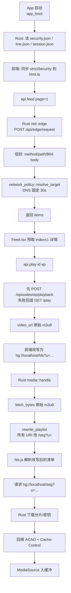

# 02 架构：模块、数据流、取舍

> 这篇回答：系统由什么组成、一次播放请求怎么走完、为什么把脏活放到 Rust 侧。

## 系统上下文

HGhub 是**单进程双语言**结构：一个 Tauri 进程里，WebView 跑 React，主线程跑 Rust，两者只通过两类通道说话——`invoke`（命令调用）和 `hg://`（自定义协议）。

外部世界只有三个对端：

- 业务 API：`https://huangguoai.com`（或镜像线路），全部收敛到 `POST /api/edge/request` 一个信封；
- 媒体源：m3u8 播放列表、分片、key、以及图片 CDN（`drleao.cn` / `hzjvlo.cn`，见 `rules/README.md`）；
- GitHub：`api.github.com/repos/Minireel/HGhub/releases/latest`，只用于检查更新（`src-tauri/src/api.rs:97-168`）。

值得先记住一个反直觉点：**业务请求和媒体请求走的是两条完全不同的路**。业务请求经过 `net::edge` 封装成信封 POST；媒体请求经过 `media::handle` 直连原始 URL 并把内容改写后回吐。前者要处理 token 与业务状态码，后者要处理 CORS 与防盗链。混在一起会两边都做不好。

## 模块地图

| 模块 | 职责 | 关键文件 |
|---|---|---|
| 应用装配 | 插件注册、窗口创建、协议注册、命令表 | `src-tauri/src/lib.rs` |
| 业务 API 命令层 | 34 个 `#[tauri::command]`，登录/列表/播放地址/互动 | `src-tauri/src/api.rs` |
| 网络传输 | 信封 POST、客户端缓存、重试、DNS 固定、诊断 | `src-tauri/src/net.rs` |
| 不可信目标策略 | 私网/保留地址拦截、HTTPS 降级拦截、严格模式开关 | `src-tauri/src/network_policy.rs` |
| 媒体代理 | 封面 AES 解密、m3u8 URI 全改写、四组内存缓存 | `src-tauri/src/media.rs` |
| 线路与镜像 | 固定线路表、发布页抓取、并发探测 | `src-tauri/src/lines.rs` |
| 会话 | token 绑定 origin、持久化 | `src-tauri/src/session.rs` |
| 诊断日志（Rust） | JSON Lines 追加、2MB×2 轮转、字段脱敏 | `src-tauri/src/playback_log.rs` |
| 调试日志 | UTC 时间戳、多行原子写 | `src-tauri/src/logging.rs` |
| macOS 窗口 | 无边框 + 红绿灯居中 | `src-tauri/src/macos_titlebar.rs` |
| 前端 API 层 | `invoke` 封装、错误归一、协议 URL 构造 | `src/api.ts` |
| 前端状态 | 全局 store、持久化、栈式导航 | `src/store.tsx` |
| 信息流播放器 | 手势、翻页、预取、键盘 | `src/components/Feed.tsx`（1329 行） |
| 播放内核 | hls.js 配置、错误恢复、seek 安全区 | `src/components/VideoSurface.tsx` |
| 播放活跃门控 | `active` / `wanted` 状态机 | `src/usePlaybackActivity.ts` |
| seek 输入模型 | 按下预览、松开提交 | `src/useSeekInput.ts` |
| 前端诊断 | 事件队列、批量 flush、跨进程关联 | `src/playbackDiagnostics.ts` |
| HTML 清洗 | DOMPurify 双次清洗、图片代理重写 | `src/html.ts` |

## 主数据流

一次「打开 App → 看到首页 → 点进一条剧 → 播起来」的完整链路：



关键分界线在 **M**：一旦前端把 URL 改写成 `hg://`，后续所有请求都不再经过 WebView 的网络栈，而是进 Rust。这条设计让 CORS、防盗链 Referer、Range 请求全部由 Rust 掌控。

## 部署/进程拓扑

只有一个进程，但有**三种线程语义**：

```text
Tauri 主进程
├── 主线程（Tauri event loop，macOS 上必须是主线程做 UI）
├── tokio runtime（rt-multi-thread）
│   ├── net::edge / fetch_bytes 的异步 HTTP
│   ├── media::handle 的 spawn（协议回调里 async move）
│   └── lines::probe 的 6 路并发探测
└── 同步互斥区
    ├── logging::DEBUG_WRITER（Mutex<()> 串行化写）
    ├── playback_log 的 ENABLED / SEQ / LOG
    └── session 的 Mutex<Session>
```

`src-tauri/src/lib.rs:79-132` 里的协议回调是 `register_asynchronous_uri_scheme_protocol`，即协议处理是异步的——这是必须的，因为 `media::handle` 里要 `await` 上游 HTTP。

## 关键设计决策

### 决策 1：业务 API 只保留一个信封入口

- **问题**：上游把 `/api/**` 收敛成 `POST /api/edge/request`，客户端如果直接拼各种 REST 路径，一旦上游调整就得逐个改。
- **方案**：`net::edge(origin, method, path, body, token)` 统一把真实 method/path/body 塞进信封，body 走 Base64（`src-tauri/src/net.rs:468-614`）。
- **代价**：所有请求变成 POST，HTTP 语义上的幂等性消失——所以 `can_retry` 必须白名单化：`(GET && body.is_none()) || (POST && operation=="play")`（`src-tauri/src/net.rs:515-516`）。
- **替代方案**：保留 REST 直连。好处是能自然用 HTTP 缓存与重试语义，坏处是上游一改路径全挂。项目选了信封。

### 决策 2：DNS 结果固定进 reqwest 客户端，30 秒 TTL

- **问题**：域名解析结果会变（CDN 调度、DNS 污染）。每次请求都重新解析既慢又可能解析到不同节点；但永久固定又会在 CDN 切换后连到死地址。
- **方案**：`client_for` 用 `{strict}:{host}:{port}` 做 key，把 `resolve_to_addrs` 的结果固定进 reqwest 客户端；`CLIENT_TTL = 30s`（`src-tauri/src/net.rs:151-194`），命中不延长 TTL。
- **代价**：30 秒内 DNS 变更不生效；缓存满了（64 条）整体清空而非 LRU 淘汰。
- **替代方案**：每次请求重新解析。项目明确拒绝，因为「共享 IPv4 出口被限流会挂起或 502/503」，需要优先 IPv6 并固定（`src-tauri/src/network_policy.rs:190-192`）。

### 决策 3：所有 URI 属性都要改写，不只是分片行

- **问题**：m3u8 里除了普通分片行，还有 `#EXT-X-KEY:URI=`、`#EXT-X-MAP:URI=`、`#EXT-X-MEDIA:URI=`、`#EXT-X-SESSION-KEY`、`#EXT-X-PART`、`#EXT-X-PRELOAD-HINT`。漏掉任何一个，hls.js 就会去直连上游，被 CORS 或防盗链拦掉。
- **方案**：`rewrite_playlist` 逐行扫，凡含 `URI="` 的行都做绝对化 + 改写成 `{prefix}/seg?u=`；同时丢弃 `#EXT-X-CONTENT-STEERING`，DATERANGE 保留 SCTE-35 等元数据但删掉 URI 与 X-ASSET-LIST（`src-tauri/src/media.rs:210-256`）。
- **代价**：手写 m3u8 解析（`hls_attributes` 处理引号内逗号），边界靠测试兜。
- **替代方案**：用现成 m3u8 解析库。项目选了手写，好处是零额外依赖且能精确控制「哪些标签要保留、哪些要丢」。

### 决策 4：镜像线路禁止登录

- **问题**：镜像线路是社区/发布页动态发现的域名，可信度低于两个固定站点。如果允许在镜像上登录，等于把账号密码交给不可控主机。
- **方案**：`trusted_auth_origin` 只认 `https://huangguoai.com` 与 `https://huangguoai.ai`；`edge` 里只要带 token 或路径是登录/注册，就强制要求可信 origin，否则报「镜像线路仅供游客浏览；登录/注册请切换到固定线路」（`src-tauri/src/net.rs:62-64`、`src-tauri/src/net.rs:476-485`）。
- **代价**：用户在镜像上看到「请切线路」的提示，体验有摩擦。
- **替代方案**：允许镜像登录但标记风险。项目选了硬拒。

## 架构亮点

### 亮点 1：策略与传输分离

`network_policy.rs` 不知道 HTTP 是什么，它只回答「这个 URL / 这组 IP 能不能连」；`net.rs` 不判断地址合法性，只调用策略。这让策略可以被单测穷举——26 个私网地址、IPv6 保留段、`127.1` 这类简写绕过全在测试里（`src-tauri/src/network_policy.rs:231-393`）。

```rust
// src-tauri/src/network_policy.rs:218-229（示意）
pub fn redirect_target_with_mode(...) -> Result<Url> {
    if strict && from.scheme() == "https" && to.scheme() != "https" {
        return Err("禁止 HTTPS 降级重定向");
    }
    ...
}
```

### 亮点 2：FakeIP 显式放行

Clash/Mihomo 的 FakeIP 模式会把域名解析到 `198.18.0.0/15`。如果严格策略无脑拦私网，开了 FakeIP 的用户全部连不上。项目的处理是**显式放行这一段**并写进测试：

```rust
// src-tauri/src/network_policy.rs:91-123（要点）
// 198.18.0.0/15 显式放行（FakeIP）
// 其余 0/8、10/8、127/8、100.64/10、169.254/16、172.16/12、192.168/16 等一律拒绝
```

`net.rs:314-329` 的 `dns_summary` 还专门返回 `has_fake_ip`，让诊断能区分「解析到 FakeIP」和「解析失败」。

### 亮点 3：代理客户端自愈

代理软件开关后，reqwest 池里的连接会卡在 tunnel error 直到超时。`heal_client` 在检测到 Connect/timeout/refused/DNS 或 proxy 错误时重建客户端，并做 3 秒节流（`src-tauri/src/net.rs:275-295`）。这是典型的「只有真实用户会踩到、只有作者自己被坑过才会写」的代码。

### 亮点 4：诊断日志双向对齐

Rust 侧 `resource_id` 用 FNV-1a 32 位把 URL 哈希成 `r{hash:08x}`（`src-tauri/src/playback_log.rs:40-46`），前端 `mediaResource` 用同样算法算同一个 ID（`src/playbackDiagnostics.ts:81-89`）。这样日志里不出现任何 URL，但前后端能对上同一个资源。测试甚至断言了 `resource_id("hello") == "r4f9f2cab"`（`src-tauri/src/playback_log.rs:262-348`）。

### 亮点 5：播放器拆成「播」与「流」

`VideoSurface.tsx` 只负责把一个 `src` 播好（hls.js 配置、错误恢复、seek 安全区），`Feed.tsx` 负责信息流的手势与翻页。1329 行的 Feed 看起来臃肿，但边界是清楚的：Feed 不碰 hls 实例的细节，VideoSurface 不知道「下一条」是什么。

## 最容易误解的点

**误解 1：以为 `hg://` 是个网络代理服务。** 它不是。它是 Tauri 的 `register_asynchronous_uri_scheme_protocol`，只在本进程内拦截特定 scheme 的请求。没有监听端口、没有对外服务。

**误解 2：以为 `LOCAL_ORIGIN` 在四个平台一样。** Windows/Android 是 `http://hg.localhost`，macOS/iOS/Linux 是 `hg://localhost`（`src-tauri/src/media.rs:21-24`）。前端 `src/api.ts:29` 必须用同样判断（`lib.rs:112-114` 的注释专门提醒）。改错的症状是封面全裂但控制台不报错——协议请求失败不进 JS 的 error handler。

**误解 3：以为严格模式关掉只是放宽一点。** 它同时关掉私网拦截、HTTPS 降级拦截、导航守卫、`hg` 协议 Origin 校验。

**一句话记住：** HGhub 的架构分界线是 URL 被改写成 `hg://` 的那一刻——之前是 WebView 的世界（CORS、同源、DOMPurify），之后是 Rust 的世界（固定 DNS、逐跳重定向检查、全 URI 改写）。
