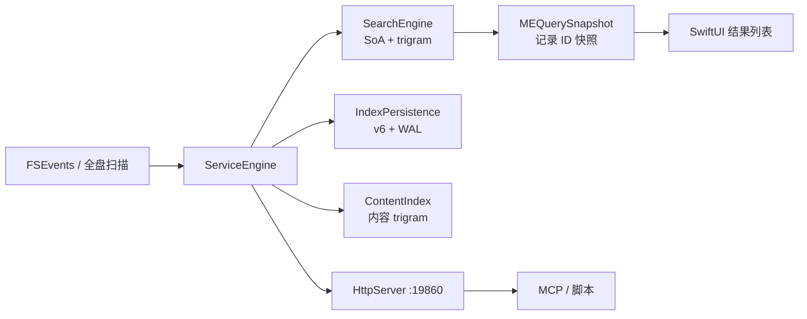

# 02 架构：模块、数据流、取舍

> 这篇回答：系统由什么组成、数据怎么流、为什么这样拆。

## 系统上下文

mac-everything 有三种入口，共用同一套 C++ 核心：

```
SwiftUI 菜单栏 App ──> Objective-C++ Bridge ──┐
maceverything-daemon（CLI）───────────────────┼──> ServiceEngine（C++20）
MacEverythingMCP（stdio 代理）──HTTP─────────┘
```

GUI 与 daemon 都直接 `new ServiceEngine`；MCP 进程不链接引擎，只是 stdio JSON-RPC 到 `localhost:19860` 的薄代理（`MacEverything/CLI/mcp_main.cpp`、`README.md:125-137`）。这避免第三个进程再持有一份 573 MiB 索引。

## 模块地图

| 模块 | 职责 | 关键文件 |
|---|---|---|
| App 壳 | 菜单栏、弹窗、快捷键、设置、Quick Look | `MacEverything/App/AppDelegate.swift:6-104`、`MacEverything/App/MacEverythingApp.swift:3-65` |
| 视图模型 | 防抖、分页、搜索历史、焦点节流 | `MacEverything/App/SearchViewModel.swift:223-427` |
| ObjC++ 桥 | 引擎生命周期、分页快照、回调切主线程 | `MacEverything/Bridge/MacSearchBridge.mm:7-32,167-198` |
| 服务编排 | 全量/增量启动、FSEvents、内容索引、HTTP | `MacEverything/Core/ServiceEngine.h:20-160`、`MacEverything/Core/ServiceEngine.cpp:100-502` |
| 扫描器 | 多线程 `getattrlistbulk` 遍历，产出 `FileRecord` | `MacEverything/Core/DirectoryScanner.cpp:43-45,145-164` |
| 搜索索引 | SoA 列、名称/扩展名倒排、路径表、Top-K 查询 | `MacEverything/Core/SearchEngine.h:112-160,262` |
| 查询前端 | 分词、AST、过滤器、glob/regex 变换 | `MacEverything/Core/QueryTokenizer.h:33-182`、`MacEverything/Core/QueryParser.cpp:32-139` |
| 持久化 | v6 扁平文件 + WAL + 自动压缩 | `MacEverything/Core/FlatIndexWriter.cpp:228-467`、`MacEverything/Core/IndexPersistence.cpp:114-271` |
| 内容索引 | 1 MiB 内文本文件的 trigram 倒排与 snippet | `MacEverything/Core/ContentIndex.cpp:111-244` |
| HTTP API | 搜索/状态/重建/内容配置 REST | `MacEverything/Core/HttpServer.cpp:323-478` |
| CLI/MCP | 无头 daemon、stdio JSON-RPC 代理 | `MacEverything/CLI/daemon_main.cpp`、`MacEverything/CLI/mcp_main.cpp` |

模块之间是单向依赖：App 只认识 Bridge 暴露的 Objective-C 接口，Bridge 只认识 `ServiceEngine` 的 C++ 接口，`ServiceEngine` 再向下持有 `SearchEngine`、`ContentIndex`、`IndexPersistence` 和 `FileSystemWatcher`。`SearchEngine` 不知道 Swift、不知道 HTTP，甚至可以脱离 App 单独被 `main.cpp` 使用；这层隔离让核心可以跑测试、跑基准、跑 daemon，而不需要启动图形界面。反过来，Swift 侧也不允许直接持有 `SearchEngine` 的裸指针，必须通过 `MEQuerySnapshot` 或 Bridge 的线程安全方法访问。

## 主数据流



启动路径有两条：缓存存在时 `startIncremental` 先加载 v6、立刻把可搜索的引擎交给 UI，再后台补 Phase 2 并回放 FSEvents（`MacEverything/Core/ServiceEngine.cpp:159-265`）；无缓存或回放超时则全盘扫描（`MacEverything/Core/ServiceEngine.cpp:271-389`）。

## 部署/进程拓扑

| 进程 | 启动方式 | 端口/通道 | 是否持索引 |
|---|---|---|---|
| MacEverything.app | LaunchServices，`LSUIElement` 菜单栏应用 | 无 | 是 |
| maceverything-daemon | `make daemon` 后手动运行 | `--port 19860` | 是 |
| MacEverythingMCP | MCP 客户端按配置拉起 | stdio → 127.0.0.1:19860 | 否 |
| 测试/基准 | `make test-all`、`benchmark` | 无 | 进程内临时 |

GUI 和 daemon 是互斥的两个“索引宿主”，因为同一 `cachePath` 只能被一个进程锁住；MCP 不持索引，所以可以和 GUI 并存。这个拓扑的好处是部署简单：普通用户只需要一个菜单栏 App；服务器只需要一个二进制；AI 工具不需要理解 C++ 或索引格式，只要会 HTTP。坏处是 GUI 崩溃会同时带走 HTTP 服务，MCP 调用会短暂失败——但由于 MCP 只是代理，重启 App 后自动恢复。

## 关键设计决策

### 决策 1：核心引擎与 UI 彻底分离，桥只做“快照”

- 问题：SwiftUI 直接操作几百万条记录会频繁跨语言拷贝，滚动时更卡。
- 方案：`MEQuerySnapshot` 只保存 `shared_ptr<SearchEngine>`、命中的 `vector<uint32_t>` 与 generation；`resultsAtOffset` 每次只把请求页物化成 `MEFileResult`（`MacEverything/Bridge/MacSearchBridge.mm:7-32`）。
- 代价：快照与引擎生命周期绑定；压缩导致 generation 变化时必须重新查询（`MacEverything/Bridge/MacSearchBridge.mm:404-421`）。
- 替代方案：一次查询返回全部结果再分页——内存峰值和跨桥成本都不可接受。

### 决策 2：v6 扁平文件 + WAL，而不是“内存映射数据库”

- 问题：600 万条记录如果逐条序列化，启动要几十秒；直接上 SQLite 又引入依赖和另一套缓存。
- 方案：11 个 section 的 SoA 扁平文件一次 `read` 装进列，WAL 记录增量操作，定期 full rewrite（`MacEverything/Core/FlatIndexWriter.cpp:228-407`、`MacEverything/Core/IndexPersistence.cpp:114-271`）。
- 代价：全量保存仍要写约 712 MiB，写放大明显（`docs/audits/2026-10-21/memory-optimization-2/report.md:61`）。
- 替代方案：LMDB/RocksDB；会多一个依赖，且仍需自己做 trigram 列布局。

### 决策 3：两阶段启动，先可搜再变快

- 问题：启动时构建全部 trigram 要数秒，用户等不了。
- 方案：`loadRecordsV6` 先装 SoA 并置 `phase2Pending_`；`completePhase2` 只快照少量列，在锁外建索引，最后加锁 swap 并 replay 期间变更（`MacEverything/Core/SearchEngineV6.cpp:11-126`）。
- 代价：Phase 2 未完成时部分查询退化为线性扫描；实现里必须维护 `phase2Pending_` 分支。
- 替代方案：同步建完再开放搜索——启动延迟直接变成用户可感知的空白。

### 决策 4：FSEvents 批量翻译成“变更计划”，单次加锁应用

- 问题：事件风暴下逐条更新会反复抢写锁，搜索被饿死。
- 方案：`collectFSEventMutations` 把一批事件归类为 `ops`、`contentUpdates`、`rescanDirs`；`applyFSEvents` 先处理内容索引，再 `batchMutate` 一次加锁（`MacEverything/Core/ServiceEngine+FSEvents.cpp:44-147`）。
- 代价：目录删除/重命名需要 `REMOVE_TREE` 或延迟重扫，逻辑比逐条处理复杂。
- 替代方案：每条事件单独改索引——实现简单但吞吐差，且容易产生中间态。

### 决策 5：单实例文件锁，而不是“相信用户只开一个”

- 问题：两个进程同时打开同一份 `index.v6` / WAL，增量写会互相覆盖，压缩时更可能把索引写坏。
- 方案：`ServiceEngine` 启动时用 `flock` 锁住缓存目录下的 `.instance.lock`，抢不到就拒绝启动（`MacEverything/Core/ServiceEngine.cpp:169-170`、`MacEverything/Core/InstanceLock.h:4-22`）。锁是进程级的 advisory lock，进程退出自动释放。
- 代价：同一用户不能同时跑 GUI 和 daemon；需要多实例时得给不同 `cachePath`。
- 替代方案：用文件锁之外的单例窗口/LaunchServices 检查——只能防 GUI，防不住 CLI。

### 决策 6：HTTP 服务放在引擎进程内，而不是另起服务

- 问题：MCP/脚本要查索引，但再起一个进程就要再加载 573 MiB 索引，或者做一套跨进程查询协议。
- 方案：`ServiceEngine` 在索引就绪后启动 `HttpServer`，默认 `19860`；MCP 进程只是 stdio 到 HTTP 的代理（`MacEverything/Core/ServiceEngine.h:50-52`、`MacEverything/CLI/mcp_main.cpp`）。
- 代价：HTTP 与 GUI 共享同一把引擎锁；本地任何进程都能访问 `localhost:19860`，没有认证。
- 替代方案：XPC 服务或独立 daemon + 共享内存；实现复杂，且仍要解决索引归属。

## 架构亮点

1. **同一份引擎三种壳**：GUI、daemon、MCP 不改核心，只换入口（`MacEverything/Core/ServiceEngine.h:28-30`）。
2. **快照分页**：查询只返回 ID，滚动时才物化，天然适配 SwiftUI 列表（`MacEverything/Bridge/MacSearchBridge.mm:17-32`）。
3. **锁外建索引**：Phase 2 和保存都尽量把重活移出共享锁（`MacEverything/Core/SearchEngineV6.cpp:60-126`、`MacEverything/Core/FlatIndexWriter.cpp:354-356`）。
4. **压缩编码按访问模式分层**：名称/路径共享前缀、元数据窄列、倒排差分 varint，各解决各的（`MacEverything/Core/DirectoryPool.h:20-44`、`MacEverything/Core/NarrowColumn.h:14-36`、`MacEverything/Core/PackedPostingList.h`）。

线程模型可以概括为“一个写队列，多个读线程”：FSEvents 回调和重扫都投递到 `mutationQueue_`，串行修改引擎；查询拿 `shared_lock` 并行读，压缩/保存拿 `mutationGate_` 阻止新写入但尽量不阻塞读（`MacEverything/Core/ServiceEngine.h:146-149`、`MacEverything/Core/SearchEngine.h:437-444`）。这也是为什么保存时更新会短暂排队，但搜索仍能继续。

## 最容易误解的点

- **“C++ 核心”不等于没有 Swift 逻辑**：防抖、分页、高亮、历史都在 Swift 侧（`MacEverything/App/SearchViewModel.swift:223-427`），核心只负责索引和匹配。
- **“573 MiB”不是 RSS**：是固定快照的物理足迹（`docs/audits/2026-10-22/path-table-dir-runs/report.md:25-31`）；实时 GUI 约 600–612 MB，RSS 会更高。
- **“WAL”不是数据库 WAL**：它是自定义的 `WAL1` 记录流，每条带 CRC，50 MB 上限，满了触发全量重写（`MacEverything/Core/IndexWAL.cpp:127-252`）。

**一句话记住：** 这套架构的核心不是“C++ 快”，而是把索引拆成可增量维护的列、把查询拆成可取消的快照、把重活拆到锁外。
