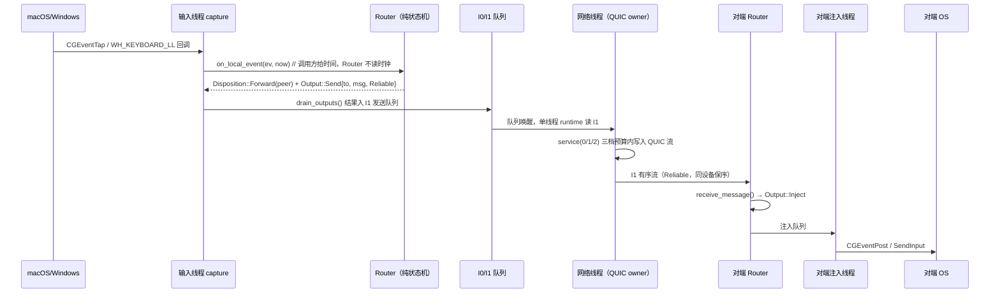

# 02 架构：16 个 crate 目录、6 类线程、一条输入链路

## 这篇回答什么问题

Oink 的模块怎么分、进程和线程怎么划、一次按键从按下去到另一台机器上打出来经过哪些函数、哪些设计决策是有意为之并且付出了代价。

## 系统上下文

Oink 站在三个操作系统边界上，自己不是操作系统的一部分：

```
        ┌──────────── 局域网（mDNS/DNS-SD + UDP 广播信标 + QUIC/UDP + TCP）────────────┐
        │                                                                              │
┌───────▼────────┐        ┌────────────────┐        ┌────────────────┐        ┌───────▼───────┐
│ macOS 设备 A   │◄──────►│ Windows 设备 B │◄──────►│ macOS 设备 C   │◄──────►│ Windows 设备 D│
│ 键鼠/显示/音频 │        │ 键鼠/显示/音频 │        │                │        │               │
└───────┬────────┘        └───────┬────────┘        └───────┬────────┘        └───────┬───────┘
        │                         │                         │                         │
   ┌────▼─────┐              ┌────▼─────┐              ┌────▼─────┐              ┌────▼─────┐
   │ CGEventTap│              │ WH_* hook│              │ CGEventTap│              │ WH_* hook│
   │ CGEventPost│             │ SendInput│              │ CGEventPost│             │ SendInput│
   │ CoreAudio │              │ WASAPI   │              │ CoreAudio │              │ WASAPI   │
   │ NSPasteboard│            │ OLE 剪贴板│             │ NSPasteboard│            │ OLE 剪贴板│
   └───────────┘              └──────────┘              └───────────┘              └──────────┘
```

它对 OS 的要求是**特权**而非集成：macOS 需要辅助功能（Accessibility）+ 输入监控（Input Monitoring），macOS 15+ 还需要本地网络授权（`crates/oink-agent/src/agent_api.rs:341-342`）；Windows 需要 SYSTEM 服务来在登录前抓输入（见下"部署拓扑"）。它不装内核驱动、不做虚拟显示器，所有跨设备动作都靠"注入原生事件"完成——这是它能在两个平台上用同一套路由逻辑的前提，也是它在某些游戏/反作弊场景下会失效的原因（`crates/oink-input/src/quicker_compat.rs` 就是为 Quicker 这类忽略 `dwExtraInfo` 的软件打的补丁）。

## 模块地图

`Cargo.toml:3-21` 列出 16 个 workspace member + 2 个非库成员（`apps/oink/src-tauri`、`tests/support`）。注意 `crates/oink-credential-provider/` 目录存在但**不在** members 里——它是 Windows 凭据提供程序的 C++ 源码，由打包脚本单独编译，不参与 cargo 构建。

| crate | Rust 行数 | 职责（取自各 `src/lib.rs` 首行文档） |
|---|---|---|
| `oink-agent` | 157765 | 组合层：`Node` 装配所有子系统、本地 IPC 服务、CLI、诊断、自动解锁编排 |
| `oink-clipboard` | 81087 | 剪贴板与文件：Provider 抽象、内容命名空间、授权、去重、Paste as File、拖拽 |
| `oink-input` | 42828 | 采集与注入，平台实现只做"翻译"不做路由决策 |
| `oink-routing` | 35942 | 输入路由纯状态机：全局唯一指针与焦点、焦点移交、防卡键、修饰键合并、手感换算 |
| `oink-network` | 29796 | 交互网络 owner + 元数据/配对/Low 服务；全部 QUIC 状态在一个私有 current-thread executor |
| `oink-audio` | 24566 | 系统输出采集、播放、claim 绑定的出口音量控制 |
| `oink-winsvc` | 18327 | Windows SYSTEM 输入服务 + 固定 UIAccess 后端启动入口 |
| `oink-protocol` | 12327 | 类型化 v1 线协议、规范 CBOR profile、分帧与准入规则 |
| `oink-display` | 10517 | 显示器枚举与布局；原生写入是受 owner 偏好控制的事务 |
| `oink-locator` | 9428 | 光标定位拖尾的绘制（何时画由路由决定，这里只画） |
| `oink-foundation` | 5102 | 共享类型、存储路径、实时调度、快照、日志 |
| `oink-telemetry` | 3810 | 无 SDK、无任意事件、无身份、无字符串、无附件的遥测 |
| `oink-crash` | 3378 | 仅本地捕获，无网络调用方 |
| `oink-update` | 2737 | 更新策略与验证，后端/SYSTEM 服务/执行器共用 |
| `oink-autostart` | 1039 | 登录项注册；**状态以系统为准，不另存开关** |

前端：`apps/oink`（React 19 + `oink-ui` 1.0.11 + Tauri 2）。关键一点写在 `apps/oink/README.md`：Tauri 壳**在独立进程里启动 backend**，两者通过 `AgentApi`（Request / Reply / ApiEvent）本地 IPC 通信；backend 拥有发现、配对、输入路由、剪贴板、持久状态。也就是说 UI 崩了不影响正在进行的跨设备输入——这不是"前端是壳"的套话，而是进程隔离的直接结果。

## 数据流：一次按键的完整路径



关键点：

1. **Router 不知道系统时间**。`crates/oink-routing/src/router.rs:1-5` 明确写它是"纯状态机，输入事件/对端消息/定时器 → 注入/发送/模式切换"，`Micros` 由调用方传入（`router.rs:83`）。所有定时行为通过 `next_deadline()`（`router.rs:1586`）暴露给外部定时器，Router 自己不注册 timer。
2. **副作用全部外化**。`drain_outputs()`（`router.rs:1575`）把决策变成 `Vec<Output>`，`Output` 枚举（`router.rs:215`）里是 `Send{to,msg,delivery}`、`Inject`、`LockWindows`、`SetMode`、`RestoreLocal{at}` 这类命令，没有一个直接调用 OS API。这让"两台虚拟设备 + 虚拟时钟"能测完整流程（`crates/oink-routing/tests/` 里有 `multi_owner_top_edge.rs`、`projection_regressions.rs`）。
3. **可靠性语义在消息上，不在连接上**。`Delivery` 只有两档（`router.rs:94`）：`Datagram` 用于游戏模式相对运动（迟到即无意义），`Reliable` 用于按键/按钮/焦点移交，且注释写明"发往同一设备的所有 Reliable 保持发送顺序：焦点移交必须先于随后的按键到达"。这个不变量是"不丢键"的根基——如果焦点移交和紧随的按键走了不同流，对端可能先收到按键而不知道该注入到哪。
4. **实时线程永不等待普通线程**。`crates/oink-agent/src/threads/mod.rs:10-14`：「Between threads there are exactly three things: one queue per stream per end; read-only snapshots replaced whole; small fixed-size commands. A realtime thread never waits for an ordinary one: no shared lock, no file I/O, no log formatting.」

## 部署拓扑：进程、线程、IPC、端口

### 进程

| 进程 | 何时存在 | 职责 |
|---|---|---|
| `oink-backend`（`crates/oink-agent/src/backend/main.rs`，`[[bin]]` 在 `crates/oink-agent/Cargo.toml:113-116`） | 常驻 | 真正的后端：发现、配对、路由、剪贴板、音频 |
| Tauri UI 进程 | 打开窗口/菜单栏/托盘时 | 纯展示 + 通过 IPC 下发 Request；崩了不影响后端 |
| Windows SYSTEM 输入服务 | 开机即在，登录前也在 | 在登录界面抓输入（`Profile::Prelogin`，`crates/oink-agent/src/node.rs:34`） |
| `oink-update-worker` | 更新时 | 独立日志角色，见 `crates/oink-agent/src/logs/files.rs:12-20` |

`Profile` 的划分值得单独说：`Profile::Prelogin`（`node.rs:34`）跑在 SYSTEM 下、由 `OinkInput` 启动，**只**装 network / routing / displays / input capture+injection，没有剪贴板、拖拽、Cloud Files、音频、本地 IPC、托盘、报告、原生界面、配对，且只用 owner 导出的 identity。这是"Windows 登录前也能被另一台机器控制"的实现方式，也是为什么 `oink-foundation/src/paths.rs:1-7` 要专门写"pre-login backend 以 SYSTEM 跑，绝不能用按账号的 LOCALAPPDATA"。

### 线程

`crates/oink-agent/src/threads/mod.rs:1-17` 是一张完整的所有权表：

| 线程 | 档位 | 独占 |
|---|---|---|
| input | realtime | capture、Router（焦点/按住键/游戏模式/边缘穿越）、运动节流与定时器、I0/I1 两端 |
| injection | realtime | 原生注入（`CGEventPost` / `SendInput` / Windows helper 管道）、已注入按键记录 |
| network | elevated 或 realtime | QUIC endpoint、全部 link/stream、心跳、cut-over、relay |
| audio | realtime | 采集编码、解码混音、M1 两端 |
| main | ordinary | 应用循环、原生窗口、拖放系统调用、macOS 菜单栏 |
| ordinary pool | ordinary | config module、各模块 stream task、剪贴板与文件、屏幕识别、mini-game、诊断、日志、IPC 服务、低优先 TCP I/O |

realtime 档位的含义在 `crates/oink-foundation/src/realtime.rs:13-30`：macOS 用 QoS class user-interactive 或 time-constraint policy（带 computation/constraint 预算），Windows 用 `THREAD_PRIORITY_HIGHEST` 或 MMCSS（input/injection 用 "Games" task，network 用 "Distribution"）。预算值：network 500µs computation / 1ms constraint，input 与 inject 250µs / 1ms。

### IPC 与端口

- **本地 IPC**：Windows 用仅当前用户 SID 可访问的命名管道，Unix 用数据目录下的私有 socket；`ipc.json` 发布原生地址、锁 owner 和一次性 secret（`crates/oink-agent/src/ipc.rs:1-8`）。协议是一行一个 JSON：`{"call": Request}` → `{"ok": Reply}`，或 `{"subscribe": true}` 后单连接推送 `ApiEvent`。
- **网络端口**：`DEFAULT_PORT = 47470`（`crates/oink-network/src/config.rs:8`），QUIC 用 `port`，发现端口 = `port + 1`（`config.rs:24` 注释），Low TCP 默认 `port + 2`（`config.rs:44`）。端口被占用时用 OS 分配，实际 TCP 端口由 `Low::Info` 单独通告（`crates/oink-network/src/link/mod.rs:97-99`）。
- **发现**：mDNS 服务类型 `_oink._udp`（`crates/oink-protocol/src/v1/mod.rs:25`）+ UDP 广播信标；macOS 走系统 DNS-SD（`crates/oink-network/src/discovery/dnssd.rs:1-4` 解释为什么不自己绑 5353——会和 mDNSResponder 抢端口，且防火墙会拦），其他平台用内置 `mdns-sd`。

## 关键设计决策

### 决策 1：路由做成纯状态机，代价是所有时间都要注入

- **问题**：输入路由的状态空间很大（按住键跨屏、多指触控板中途换设备、游戏模式、掉线重连、系统锁屏），两台真机测不完。
- **方案**：`Router` 只接受 `(event, now)`，只输出 `Output`；不读时钟、不做 I/O、不格式化日志。证据：`router.rs:1-5`、`drain_outputs` 在 `router.rs:1575`。
- **代价**：每个真实副作用都要有对应的 `Output` 变体和执行者；`Output` 枚举成了事实上的系统接口，改它要动 input 线程的执行器。
- **替代方案**：让 Router 直接调 OS API 并用 mock 替换——那样 mock 的边界会渗进生产代码。

### 决策 2：网络全部状态收进一个单线程 runtime

- **问题**：多链路 + 多流 + 心跳 + relay cut-over 如果散在多线程，锁的层级会爆炸。
- **方案**：`crates/oink-network/src/lib.rs:1-4`「All QUIC state lives on one private current-thread executor」；对外 `LinkLayer` 是可克隆句柄，每个方法"返回前不等网络线程"（`link/mod.rs:118-121`）。
- **代价**：一轮最多 500µs，超了要计数并降级（`link/runtime.rs:270-310` 的 `over_budget`、`late_rounds`、`demoted` 都是可观测指标）。
- **替代方案**：多线程 + `Arc<Mutex<...>>`，但实时路径上任何一次锁竞争都是可见的卡顿。

### 决策 3：可靠性交给 QUIC，自己不实现 seq/ack/重传

- **问题**：自研可靠传输是最容易写出隐蔽 bug 的地方。
- **方案**：`link/mod.rs:1-21` 明确"可靠性/重传/流控/拥塞交给 QUIC 与内核 TCP，无 seq/ack/replay/credit"；应用层只保留两档语义（Reliable / Datagram）。
- **代价**：Datagram 是真的会丢，游戏模式的相对运动必须能容忍丢包；Reliable 的保序只保证"同一设备"，跨设备无全局序。
- **替代方案**：自己写 ARQ——在 500µs 预算里不可能做对。

### 决策 4：每个实时子系统一个 owner 线程，线程间只有三样东西

- **问题**：实时线程不能等普通线程（文件 I/O、锁、日志格式化都会造成抖动）。
- **方案**：线程间只允许：每流每端一个队列、整块替换的只读快照（`oink_foundation::snapshot::Snapshot`）、小的定长命令。
- **代价**：状态更新是"整体替换"而非增量，快照会重复拷贝；模块间不能共享可变状态。
- **替代方案**：`RwLock` 保护共享状态——读侧仍可能被写侧阻塞。

### 决策 5：Windows 用固定启动配方（OBL1），不用命令行参数传状态

- **问题**：SYSTEM 服务要启动一个跑在用户桌面、带 UIAccess 的后端进程，参数如果可伪造就是提权面。
- **方案**：`crates/oink-winsvc/src/backend_launch.rs:20` 定义 `MAGIC b"OBL1"`，`encode:69` / `decode:129` 走定长帧且有 `MAX_FRAME` 上限；`launch_recipe.rs`、`token_policy.rs`、`console_policy.rs`、`prelogin_route.rs` 各自只回答一个问题。
- **代价**：新增启动参数要同时改编码器、解码器、策略和测试。
- **替代方案**：JSON 配置文件——但配置文件可被同用户改写，等于把提权入口交给普通进程。

## 架构亮点

1. **纯状态机 + 注入时间**：`router.rs:1-5` + `Micros` 注入 + `next_deadline()`，让"两台虚拟设备 + 虚拟时钟"能跑完整回归。
2. **线程所有权表写进模块文档**：`threads/mod.rs:1-17` 是一张可直接 review 的表，新线程必须在这里登记归属，否则没人知道它能不能碰实时路径。
3. **调度降级可观测**：`realtime::apply` 设置后立刻 `read_back()`，之后每 5s 复查一次（`realtime.rs:8`），不一致就计 `demoted`——不是"设了就假设生效"。
4. **协议常量集中且带理由**：`crates/oink-protocol/src/v1/limits.rs` 一份表管所有上限（16KiB 可靠帧、1100B datagram、16MiB Low 帧、256 单向流、0 双向流），`frame.rs:5-20` 再映射成运行时视图。
5. **流类型即优先级**：`StreamKind::priority()` 只分两档，`Internal | Input → Interactive`，其余 `Normal`（`crates/oink-protocol/src/frame.rs`）。优先级不是配置项，是流类型的函数——少一个可以配错的东西。
6. **诊断走独立 layer**：普通日志级别由用户偏好控制，但"审计过的诊断事件"永远进入独立 layer（`crates/oink-agent/src/logs.rs:8`），所以关掉日志不会关掉排障能力。
7. **授权是持久对象，不是一次判定**：剪贴板文件授权 `SourceGrants` 把 `LinkToken([u8;32])` 与设备绑定并落盘（`crates/oink-clipboard/src/content/grants.rs:43,276,515`），journal 只存元数据、永不存收到的文件字节。

## 读架构时最容易误解的点

- **"P2P"不等于"没有中心"**。发现和配对有一个"configuration owner"负责串行化和持久提交（`crates/oink-network/src/pairing.rs:1-2`），组状态是签名的不可变成员记录（`crates/oink-network/src/roster.rs:1-2`）。P2P 指的是**数据平面**没有固定 server，不是控制平面没有协调者。
- **"单线程网络"不等于"低性能"**。它换的是可预测性：一轮 500µs 分三段花（100µs 自己的活、250µs 交互流、150µs 普通流），未用完结转（`link/mod.rs:87-90`）。
- **"纯状态机"不等于"没有 OS 依赖"**。`LayoutQuery` 是 trait（`crates/oink-routing/src/layout.rs`），实现必须纯计算因为会在截获回调快路径里被调用——但它的数据来自 `oink-display` 的真实枚举。
- **`oink-agent` 15.8 万行不是"上帝对象"**。它是组合层：`node.rs` 装配、`streams/` 每模块一个 stream task、`threads/` 每线程一个模块、`api.rs` 是 Request/Reply 的类型表。真正的逻辑都在下层 crate。
- **`oink-credential-provider` 不在 workspace 里**。看到目录别以为有 Rust 代码，它是 C++ 的 Windows 凭据提供程序。

## 一句话记住

Oink 的架构只有一条主线：**把每个"不确定"从实时路径上赶走**——时间由调用方注入、网络状态收进单线程、线程间只留队列/快照/命令、可靠性交给 QUIC，代价是所有边界都要显式建模，收益是 44 万行代码仍然能被一个人维护。
