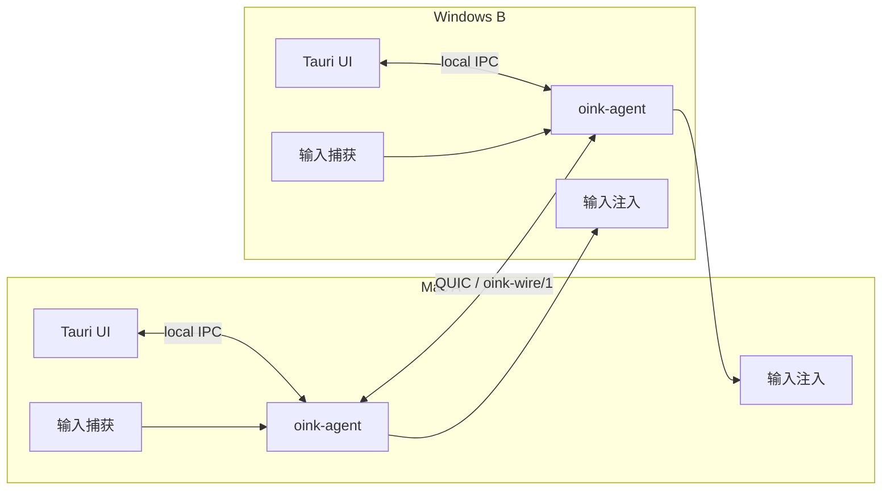
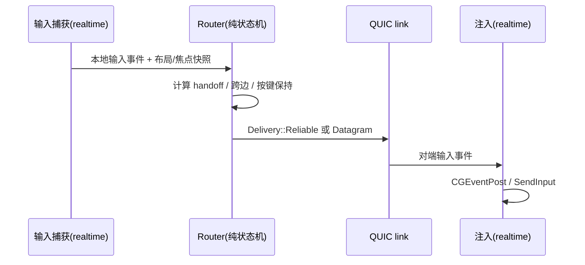
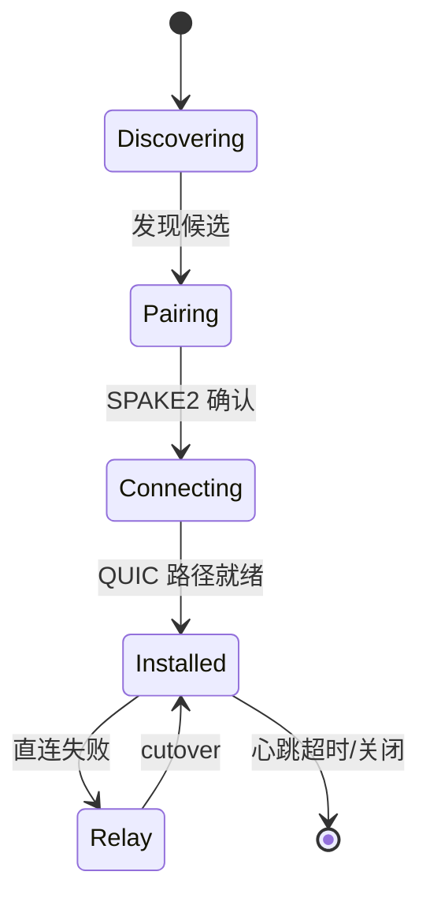

# 02 架构：一个桌面 KVM 如何拆成实时系统

> 证据基准：`oinkvm/oink@546f65b` 本地 clone。所有路径都可回到 `https://github.com/oinkvm/oink/blob/546f65b2135e7a1491d2d743f0a1e072a74df36f/<path>`。

## 系统上下文

Oink 是“本地优先”的桌面应用，没有中心服务器。每台设备运行同一个 agent；设备之间通过局域网发现、配对，然后建立 QUIC 连接。典型拓扑：

关键点：UI 不是后端。`apps/oink/README.md:3-7` 说明 Tauri 壳只负责窗口/菜单/后端进程生命周期，真正的设备发现、配对、输入路由、剪贴板、持久化状态都在 `crates/oink-agent/`，两者通过本地 IPC 的 `AgentApi` 通信。

## 模块地图

根 `Cargo.toml:3-21` 列出 workspace 成员。可以按“职责”分成五层：

| 层 | crate | 职责 | 关键证据 |
|---|---|---|---|
| 基础类型 | `oink-foundation` | ID、几何、输入值、剪贴板内容、快照、实时调度、路径 | `crates/oink-foundation/src/lib.rs` |
| 协议 | `oink-protocol` | v1 线格式、帧、CBOR/DTO、流类型、错误 | `crates/oink-protocol/src/frame.rs:16-57` |
| 网络 | `oink-network` | QUIC 端点、发现、配对、链路、心跳、relay、cutover | `crates/oink-network/src/lib.rs:1-3` |
| 领域逻辑 | `oink-routing` / `oink-input` / `oink-display` / `oink-clipboard` / `oink-audio` | 输入路由、捕获、显示布局、剪贴板、音频 DSP | `crates/oink-routing/src/router.rs:94-130` |
| 编排/平台 | `oink-agent` / `oink-winsvc` / `apps/oink/src-tauri` | 线程编排、IPC、Windows 服务、Tauri UI | `crates/oink-agent/src/threads/mod.rs:1-15` |

辅助 crate：`oink-telemetry`（指标）、`oink-crash`（崩溃采集）、`oink-update`（更新）、`oink-autostart`（登录启动）、`oink-locator`（窗口定位/通知）。

## 进程与线程模型

### 进程

- **UI 进程**：Tauri 应用，负责主窗口、菜单栏、托盘、设置页。
- **Backend 进程**：`oink-agent`，负责所有网络/输入/剪贴板/音频。UI 通过本地 IPC 调它。
- **Windows 服务**：`oink-winsvc`，SYSTEM 权限，负责在登录前/登录界面也能提供输入能力；它再启动一个固定路径的 user-session backend。
- **Prelogin backend**：Windows 登录前模式，只启用网络、路由、显示、输入；不启用剪贴板/音频/配对/报告（`crates/oink-agent/src/node.rs` 的 `Profile`/`Components`）。

### 线程

`crates/oink-agent/src/threads/mod.rs:3-15` 给出一张非常值得背下来的表：

| 线程 | 层级 | 独占资源 |
|---|---|---|
| input | realtime | 捕获、router（焦点/按键保持/游戏模式/跨边）、motion pacing、I0/I1 两端 |
| injection | realtime | 原生注入（`CGEventPost`、`SendInput`、Windows helper 管道）、已注入按键记录 |
| network | elevated/realtime | QUIC endpoint、所有 link/stream、心跳、cutover、relay |
| audio | realtime | 采集/编码、解码/混音、M1 两端 |
| main | ordinary | UI IPC、生命周期、普通任务 |

线程之间只有三种东西：**每条流每端一个队列**、**整块替换的只读快照**、**小固定尺寸命令**。实时线程不等待普通线程：没有共享锁、没有文件 I/O、没有日志格式化（`crates/oink-agent/src/threads/mod.rs:12-15`）。这句话是整套架构的核心约束。

## 关键数据流

### 1）输入：从一台机器到另一台

- Router 是纯逻辑：不碰 I/O、不读时钟，所有环境通过输入参数传入（`crates/oink-routing/src/router.rs:94-130`）。
- `Delivery::Reliable` 用于控制/键盘等必须有序的事件；`Delivery::Datagram` 用于游戏相对运动等“迟到就无意义”的事件（`router.rs:94-102`）。
- 布局查询抽象成 `LayoutQuery` trait，屏幕坐标/跨边/portal 由它回答（`crates/oink-routing/src/layout.rs:31`、`56`）。

### 2）网络：一条 link 的生命周期

`crates/oink-network/src/link/mod.rs:53-90` 把预算写成常量：心跳 500ms、超时 2s、空闲 10s、keep-alive 5s、最多 8 条 dial、单次 dial 3s、relay 3s、cutover 500ms、直接重试 15/15/30/60s，以及每轮调度预算 500µs/100µs/250µs/150µs。**这些不是注释，是运行时行为**。

### 3）剪贴板：懒加载 + 授权

`crates/oink-clipboard/src/content.rs:101` 定义 `Provider` trait：内容不是“复制时立刻全量传输”，而是先发布一份描述（有哪些 representation），接收方按需打开/读取。`content.rs:237` 的注释说得很直白：“guessing an omitted representation ID grants nothing.” 这避免了“为了复制一张图，把整个剪贴板历史都传过去”的浪费，也把权限边界放在 grant 层。

### 4）音频：有界队列 + 抖动缓冲

`crates/oink-audio/src/dsp.rs:8-17`：48kHz 立体声；Opus 10ms / 128kbps、PCM16 2.5ms、PCM24 无损；包上限 960 字节；目标缓冲 3 帧、最大队列 12 帧、最大 PLC 6 帧。`dsp.rs:1589` 说明 deliberate reserve 变化用连续重采样，最多 -0.2%。这是一套“实时音频不能无限排队”的典型答案。

## 架构亮点

### 亮点 1：纯决策核心 + 命令式外壳

Router 不依赖 I/O/时钟，所有副作用在 agent 线程里执行。好处：

- 可以用单元测试覆盖“按住 Shift 跨屏”“触控板多指跨边”“游戏模式相对运动”等边界，而不需要真实两台机器。
- 出问题时可以复现“输入序列”，而不是复现“桌面环境”。

代价：所有环境都要显式建模，类型和参数会变多；这是为可测试性付的税。

### 亮点 2：每个实时子系统只有一个 owner 线程

网络线程独占 QUIC endpoint；输入线程独占 router；注入线程独占原生注入；音频线程独占采集/编码。线程间不共享锁，只传队列/快照/命令。这样做的直接收益是**没有跨线程锁竞争**，延迟可预测；代价是每个模块都要定义消息协议，调试链路更长。

### 亮点 3：协议是一等公民

`crates/oink-protocol/src/frame.rs:16-57` 定义流类型：`N0/N1`（网络控制）、`C0`（控制）、`I0/I1`（输入）、`B0`（业务）、`M0/M1`（媒体）、`A0`（音频？按枚举顺序）、`Diagnostics=8`、`Wallpaper=9`、`Dnd=10`、`Cache=11`、`Projection=12`、`LayoutProfiles=13-15`。`MAX_UNI_STREAMS=256`、`MAX_BIDI_STREAMS=0`、接收窗口 64KiB。它把“哪些流量可以抢占、哪些必须有序”编码进流类型，而不是靠运行时猜。

### 亮点 4：平台差异放在边缘

macOS 用 `objc2`/AppKit 做菜单、窗口、输入注入；Windows 用 `windows` crate + `oink-winsvc` 做服务、UIAccess、`SendInput`。核心 routing/protocol/network 不关心平台。这样新增平台时，理想情况下只加一个 platform adapter，而不是改核心状态机。

### 亮点 5：Windows 登录前能力

`crates/oink-winsvc/src/backend_launch.rs:1` 说明这是“fixed backend launch recipe”的本地会话管道协议，magic `OBL1`（`backend_launch.rs:20`）。服务端不接受任意可执行路径/参数，减少提权攻击面。这个设计对“远程开机/登录界面也要能用键鼠”的产品很关键。

## 架构代价与风险

- **自研协议**：不兼容 Synergy/Deskflow，生态孤立；但换来对延迟/流控/安全的完全控制。
- **线程模型复杂**：每个实时线程都要手写队列和生命周期，代码量大；`oink-agent` 有 309 个源文件，理解成本高。
- **平台只覆盖 macOS/Windows**：Linux 用户无法使用；跨平台抽象没有经过第三平台验证。
- **新项目**：0.3.3，协议 `SPEC_REVISION=2026-10-15-ui-freeze`，未来仍可能 breaking change。

## 建议的阅读顺序

1. `crates/oink-agent/src/threads/mod.rs:1-15`：先记住线程所有权表。
2. `crates/oink-routing/src/router.rs:94-130`：看纯状态机的输入/输出。
3. `crates/oink-network/src/link/mod.rs:53-90`：看预算常量。
4. `crates/oink-protocol/src/frame.rs:16-57`：看流类型。
5. `crates/oink-clipboard/src/content.rs:101`：看懒加载 Provider。
6. `crates/oink-audio/src/dsp.rs:8-17`：看音频边界。

## 关键证据

- Workspace 成员：`Cargo.toml:3-21`
- UI/后端分离：`apps/oink/README.md:3-7`
- 线程所有权：`crates/oink-agent/src/threads/mod.rs:3-15`
- Router 纯逻辑：`crates/oink-routing/src/router.rs:94-130`
- 布局抽象：`crates/oink-routing/src/layout.rs:31`、`56`
- 网络预算：`crates/oink-network/src/link/mod.rs:53-90`
- 协议流类型：`crates/oink-protocol/src/frame.rs:16-57`
- 剪贴板 Provider：`crates/oink-clipboard/src/content.rs:101`、`237`
- 音频边界：`crates/oink-audio/src/dsp.rs:8-17`、`1589`
- Windows 固定启动：`crates/oink-winsvc/src/backend_launch.rs:1`、`20`
