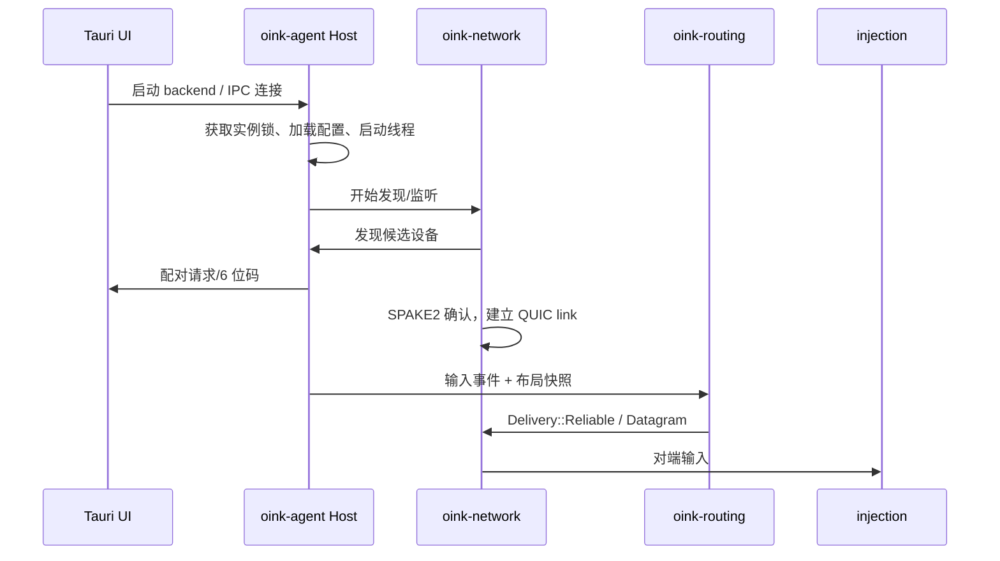

# 03 代码导览：从 clone 到能改一个功能

> 目标：让你在 1–2 小时内建立“这个仓库怎么跑、代码在哪、改哪里”的地图。
> 证据基准：`oinkvm/oink@546f65b`。仓库共约 3944 个文件，直接从头读会迷路，按本文顺序读。

## 仓库顶层

```text
oink/
├── Cargo.toml                 # Rust workspace，15 个 crate + Tauri app
├── package.json               # 根 npm workspace
├── apps/
│   ├── oink/                  # React 前端 + Tauri 壳
│   ├── audio-plugin/          # macOS 音频插件（CoreAudio）
│   └── file-provider/         # macOS File Provider 扩展
├── crates/
│   ├── oink-foundation/       # 基础类型/几何/快照/实时调度
│   ├── oink-protocol/         # v1 线格式、DTO、流类型
│   ├── oink-network/          # QUIC、发现、配对、链路
│   ├── oink-routing/          # 输入路由纯状态机
│   ├── oink-input/            # macOS/Windows 输入捕获
│   ├── oink-display/          # 显示器布局/投影
│   ├── oink-clipboard/        # 剪贴板/拖拽内容
│   ├── oink-audio/            # 音频采集/编码/DSP
│   ├── oink-agent/            # 编排、线程、IPC、业务
│   ├── oink-winsvc/           # Windows 服务/prelogin
│   ├── oink-update/           # 更新 feed/签名
│   ├── oink-telemetry/        # 指标
│   ├── oink-crash/            # 崩溃采集
│   ├── oink-autostart/        # 登录启动
│   └── oink-locator/          # 窗口定位/通知
├── packaging/                 # macOS/Windows 打包、签名、feed
├── build-support/             # 构建脚本/CI
├── tests/support/             # 测试辅助
└── .github/workflows/         # CI、release、feed 发布
```

## 先读这 10 个文件

| 顺序 | 文件 | 读它回答什么问题 | 建议时间 |
|---|---|---|---|
| 1 | `README.md` | 产品是什么、支持什么、怎么贡献 | 5 min |
| 2 | `Cargo.toml:3-21` | 有哪些 crate，边界在哪 | 3 min |
| 3 | `apps/oink/README.md:3-25` | UI 与 backend 怎么分、怎么跑前端 | 5 min |
| 4 | `crates/oink-agent/src/threads/mod.rs:1-15` | 实时线程所有权表（全文最重要的 15 行） | 10 min |
| 5 | `crates/oink-agent/src/node.rs` | `Profile`/`Components`：普通模式 vs prelogin | 8 min |
| 6 | `crates/oink-routing/src/router.rs:94-130` | 纯 router 的输入/输出/约束 | 10 min |
| 7 | `crates/oink-network/src/link/mod.rs:53-90` | 网络预算常量 | 5 min |
| 8 | `crates/oink-protocol/src/frame.rs:16-57` | 流类型与多路复用 | 8 min |
| 9 | `crates/oink-clipboard/src/content.rs:101` | 剪贴板为什么是懒加载 | 8 min |
| 10 | `crates/oink-audio/src/dsp.rs:8-17` | 音频队列/包上限 | 5 min |

## 构建与运行

### 前端（最快）

`apps/oink/README.md:15-23` 给出根目录命令：

```bash
npm ci
npm run -w apps/oink dev        # 浏览器预览 http://127.0.0.1:1440
npm run -w apps/oink typecheck
npm run -w apps/oink test
npm run -w apps/oink build
```

浏览器预览只能看界面；原生能力（输入注入、托盘、音频）必须跑 Tauri 壳。

### 原生（macOS / Windows）

前置：

- macOS 14.2+，Apple silicon（`README.md:20`）
- Windows 10 22H2+ / 11，x64（`README.md:21`）
- Rust 1.99.0（CI 固定，`.github/workflows/ci.yml`）
- Node 24.14.1、npm 11.11.0（CI 固定）
- Python 3.14.6（打包/测试）
- Tauri 2.12.x 对应系统依赖

常用命令：

```bash
cargo build -p oink-ui
cargo test -p oink-routing
cargo test -p oink-network
cargo test -p oink-protocol
python build-support/ci.py
```

> 打包链路看 `build-support/README.md:1-14`：`package.py` 调 `build.py`，一次 Cargo build 同时产出 `oink-ui`、`oink-agent`、`oink-crash`，Windows 再加 `oink-winsvc`；`custom-protocol` 把前端嵌进可执行文件。

## 启动流程（从进程到第一条输入）



关键入口：

- `crates/oink-agent/src/host.rs`：拥有 Tokio runtime、Node、进程锁、IPC listener。
- `crates/oink-agent/src/node.rs`：按 `Profile` 决定启用哪些 `Components`。
- `crates/oink-agent/src/boot.rs`：启动顺序。
- `crates/oink-agent/src/backend/`：backend 进程生命周期（macOS/Windows 分开）。

## 四条主流程的代码路径

### 1）输入捕获 → 路由 → 发送

| 步骤 | 代码 |
|---|---|
| macOS 捕获 | `crates/oink-input/src/macos/`（`cursor.rs`、`contacts.rs`、`activity.rs`） |
| Windows 捕获 | `crates/oink-input/src/windows/` |
| 事件模型 | `crates/oink-foundation/src/input.rs` |
| 路由 | `crates/oink-routing/src/router.rs`、`router/` 子模块 |
| 布局/跨边 | `crates/oink-routing/src/layout.rs`、`display_layout.rs` |
| 发送 | `crates/oink-agent/src/` 的 input 线程 → `oink-network` |

### 2）接收 → 注入

| 步骤 | 代码 |
|---|---|
| 网络收包 | `crates/oink-network/src/link/` |
| 协议解码 | `crates/oink-protocol/src/v1/` |
| 注入 | `crates/oink-agent/src/` injection 线程；macOS `CGEventPost`，Windows `SendInput`/helper |
| 按键保持 | `crates/oink-routing/src/router/held*`、`focus_lock.rs` |

### 3）剪贴板/拖拽

| 步骤 | 代码 |
|---|---|
| 内容模型 | `crates/oink-clipboard/src/content.rs` |
| Provider | `crates/oink-clipboard/src/content.rs:101` |
| 授权/生命周期 | `crates/oink-clipboard/src/content/grants/` |
| 拖拽状态机 | `crates/oink-routing/src/router/dnd.rs`、`router/dnd/` |
| macOS File Provider | `apps/file-provider/` |
| Windows 原生拖拽 | `apps/oink/src-tauri/native/package-drop-windows.cpp` |

### 4）音频

| 步骤 | 代码 |
|---|---|
| 采集/播放 | `crates/oink-audio/src/` + `native/` |
| DSP/编解码 | `crates/oink-audio/src/dsp.rs` |
| 链路 | `crates/oink-agent/src/audio/link.rs` |
| macOS 插件 | `apps/audio-plugin/` |

## 改一个功能：示例“新增一个输入事件”

假设你要加“手势滑动切屏”事件。按依赖顺序改：

1. **基础类型**：`crates/oink-foundation/src/input.rs` 加事件枚举/字段。
2. **协议 DTO**：`crates/oink-protocol/src/v1/dto/input_values.rs` 加序列化类型；同步改 `tests/fixtures/v1/` 的 golden 测试。
3. **路由决策**：`crates/oink-routing/src/router.rs` 或 `router/gesture.rs` 加状态转移；补 `#[test]`。
4. **线程编排**：`crates/oink-agent/src/threads/` 确认事件走哪个队列；实时线程不做分配/日志。
5. **平台注入**：`crates/oink-input/src/macos/` 或 `windows/` 产生事件；`injection` 线程消费。
6. **UI 设置**：`apps/oink/src/settings/` + `src/i18n/` 增加开关/文案。
7. **测试**：`cargo test -p oink-routing`、`cargo test -p oink-protocol`，再跑 `python build-support/ci.py`。

## 代码风格与约定

- `Cargo.toml:57-66`：`unsafe_op_in_unsafe_fn=deny`，`missing_debug_implementations=warn`，`dbg_macro/todo/unimplemented` 警告。
- 模块文档很密：很多文件开头就是“这个模块拥有什么、不做什么”，例如 `threads/mod.rs:1-15`、`network/src/lib.rs:1-3`。
- 注释中英混合；关键约束会写成 `//!` 模块文档或 `///` 文档注释。
- 测试与代码同目录/同 crate：`router/*_tests.rs`、`protocol/tests/v1_*.rs`、`audio/dsp.rs` 底部大量 `#[test]`。
- 前端用 `oink-ui` 组件库 + `--ok-*` CSS 变量；文案必须走 `src/i18n/`（`apps/oink/README.md:25-27`）。

## 调试入口

- 日志：`crates/oink-agent/src/logs.rs`；设置里有 `log_level`/`log_max_mb`（`agent_api.rs:998-1001`）。
- 诊断：`crates/oink-telemetry/`、`oink-protocol` 的 `Diagnostics` 流（`frame.rs:45`）。
- 网络：`oink-network/src/link/diagnostics.rs`；`tracing` target `oink_link_diagnostics`。
- 输入：`oink-input/src/diagnostics.rs`、`contact_diagnostics.rs`。
- 音频：`oink-audio/src/diagnostics.rs`、`allocation_audit.rs`。
- 崩溃：`oink-crash/`（macOS crash report / Windows dump）。

## 关键证据

- 顶层结构：`Cargo.toml:3-21`、仓库 tree
- 前端/后端边界：`apps/oink/README.md:3-7`
- 前端命令：`apps/oink/README.md:15-23`
- 打包链路：`build-support/README.md:1-14`
- 线程表：`crates/oink-agent/src/threads/mod.rs:1-15`
- Router：`crates/oink-routing/src/router.rs:94-130`
- 协议流：`crates/oink-protocol/src/frame.rs:16-57`
- 剪贴板：`crates/oink-clipboard/src/content.rs:101`
- 音频：`crates/oink-audio/src/dsp.rs:8-17`
- 代码风格：`Cargo.toml:57-66`
