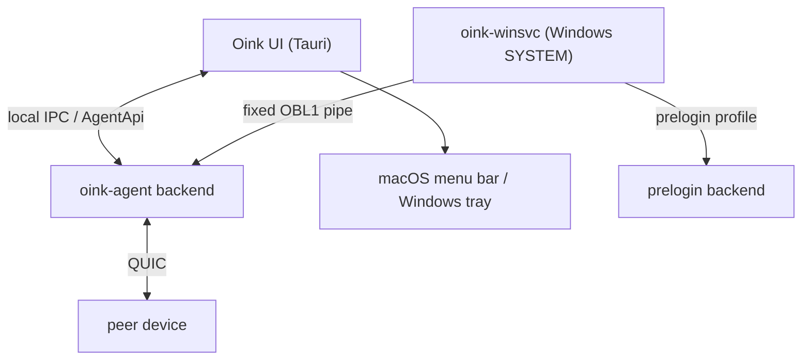

# 09 运维：装、跑、排障、回滚

> Oink 是桌面应用，不是服务端；但它的进程/服务/更新链路有很强的“运维”味道。本文给的是实际排障会用的路径和命令。

## 安装

- 下载：GitHub Releases（`README.md:14-16`）。
- macOS：Apple silicon（arm64）only，macOS 14.2+（`README.md:20`）。
- Windows：x64，Windows 10 22H2（build 19045）+ 或 Windows 11（`README.md:21`）。
- Windows SmartScreen/UAC：README 说明可能提示未知发布者；只在确认来源时选择“更多信息 → 仍要运行”（`README.md:23`）。

## 进程模型

- **UI 进程**：窗口、菜单、托盘、设置。
- **Backend 进程**：设备发现、配对、输入路由、剪贴板、音频。
- **Windows 服务**：SYSTEM 权限，登录前/登录界面也能提供输入；通过固定启动配方拉起 user-session backend。
- **macOS**：菜单栏应用 + Tauri 主窗口；无 Windows 那种服务。

## 数据/日志路径

`crates/oink-foundation/src/paths.rs:24-45`：

| 平台 | data | cache | logs |
|---|---|---|---|
| macOS | `~/Library/Application Support/Oink` | `~/Library/Caches/com.hachiwii.oink` | `~/Library/Logs/Oink` |
| Windows | `%LOCALAPPDATA%\Oink` | `%LOCALAPPDATA%\Oink\Cache` | `%LOCALAPPDATA%\Oink\Logs` |
| 隔离模式 | `OINK_HOME` 指定目录 | `<OINK_HOME>/Cache` | `<OINK_HOME>/Logs` |

常见文件：

- `settings.json`（`crates/oink-agent/src/config.rs:33`）
- `addresses.json`（`config_module/local_records.rs:16`）
- `pairing-blocks.cbor`、`presence.cbor`（`config/records.rs:11-12`）
- `clipboard-clock.json`（`clip/src/runtime.rs:41`）
- `source-file-links/`（剪贴板源文件授权缓存）

> Windows prelogin backend 以 SYSTEM 运行，不能使用某个用户的 `LOCALAPPDATA`；`paths.rs:3-6` 说明它会固定 machine-level roots。

## 启动/停止

- 正常启动：双击应用 / 登录项启动。
- macOS 菜单栏：显示/隐藏窗口、暂停/恢复、锁定/解锁、退出。
- Windows 托盘：同上。
- 停止 backend：退出应用；Windows 服务版由服务控制。
- 登录启动：`oink-autostart` crate；Windows 安装器有 `Start Oink when I sign in` 选项（`build-support/README.md:56-62`）。

## 配置

- 应用内设置：`settings.json`；日志级别/大小、音频质量、布局、权限提示等。
- 日志级别/上限：`agent_api.rs:998-1001` 的 `log_level` / `log_max_mb`。
- 音频：Opus/PCM 配置、麦克风、音量；见 `crates/oink-audio/`。
- 布局：`oink-display` + `oink-routing`；多屏/DPI 变化会自动重算。

## 排障清单

### 1）设备发现不到

- 确认同一局域网、未开启 AP 隔离/客户端隔离。
- 检查防火墙是否放行 UDP（mDNS `_oink._udp` + QUIC）。
- 看 `oink-network/src/discovery/` 的日志；手动地址用 `addresses.json`。
- 跨子网/VLAN 需要手动地址或 relay；mDNS 不跨广播域。

### 2）能发现但连不上

- 看 `oink_link_diagnostics` target 的日志：`connection_step`、`path_install`、`config_ready`。
- 检查 `DIAL_BUDGET=3s` 是否被防火墙拖超时。
- 尝试手动地址；看是否走 relay。
- 检查系统时间（TLS 证书验证依赖时间）。

### 3）配对失败

- 6 位码是否一致；配对有 attempt 限制（1..=3）。
- 看 `group_pake` 错误：`invalid pairing transcript` 表示 transcript 不匹配（角色/帧/身份/attempt）。
- 删除旧的配对记录（`pairing-blocks.cbor`/`presence.cbor`）后重试，注意会丢历史。

### 4）键鼠跨屏卡顿/丢键

- 看输入线程是否被降级（`threads/mod.rs` 的 realtime tier）。
- 检查是否有大文件拖拽/剪贴板传输占满普通流。
- 看 router 是否频繁 `Refused`（按键保持/焦点锁）。
- 游戏模式用 datagram；普通模式用 reliable；确认场景匹配。

### 5）音频爆音/延迟

- 看 `oink-audio` 诊断：`queued_frames`、`lost`、`resample_ns`、`underrun`。
- `MAX_QUEUE_FRAMES=12`、`MAX_PLC_FRAMES=6`：持续丢包会触发 PLC，爆音是预期降级。
- 检查采样率/声道是否匹配；PCM24 无损带宽高，优先 Opus。
- macOS 音频插件（`apps/audio-plugin/`）是否安装/权限正确。

### 6）Windows 登录界面不能用

- 检查 `oink-winsvc` 服务是否运行。
- 安装时是否勾选 “Start Oink when I sign in”（会启用 machine-level prelogin backend，`build-support/README.md:56-62`）。
- 看 `backend_launch.rs` 的 `OBL1` 协议日志；固定启动配方失败会回退/停止，不会任意执行路径。

### 7）更新失败

- 看 `crates/oink-update/`：feed、trust、transaction、barrier。
- Windows/macOS feed 在 `update-feed-state` 分支；发布工作流是 `publish-*-feed.yml` + `deploy-feed.yml`。
- 部署失败会自动回滚并验证回滚字节（`deploy-feed.yml`）。
- 检查系统时间、证书、Ed25519 公钥是否匹配。

## 备份/恢复

| 内容 | 路径 | 备份建议 |
|---|---|---|
| 设置 | `settings.json` | 改大版本前备份 |
| 地址簿 | `addresses.json` | 手动地址多时备份 |
| 配对记录 | `pairing-blocks.cbor`、`presence.cbor` | 一般不需要；删除可重置配对 |
| 日志 | `Logs/` | 排障时打包 |
| 剪贴板缓存 | `Cache/`、`source-file-links/` | 不需要；可清理 |

## 安全注意事项

- 只从 GitHub Releases 下载；不要用来路不明的安装包。
- Windows 服务/UIAccess 是高权限组件；不要手动替换 `oink-winsvc` 二进制。
- 剪贴板可能包含密码/密钥；Oink 默认加密传输，但本机日志/缓存仍可能落盘，注意清理。
- GPL-3.0-only + additional terms：分发修改版要提供源码、保留归属、不得用 Oink 名称推广（`README.md:49-54`）。

## 关键证据

- 平台/安装：`README.md:14-23`
- 路径：`crates/oink-foundation/src/paths.rs:24-45`
- 配置文件名：`crates/oink-agent/src/config.rs:33`、`config/records.rs:11-12`、`config_module/local_records.rs:16`
- 日志设置：`crates/oink-agent/src/agent_api.rs:998-1001`
- Windows 服务/固定启动：`crates/oink-winsvc/src/backend_launch.rs:1`、`20`
- 更新：`crates/oink-update/src/`、`.github/workflows/publish-windows-feed.yml`、`deploy-feed.yml`
- 安装器登录启动：`build-support/README.md:56-62`
