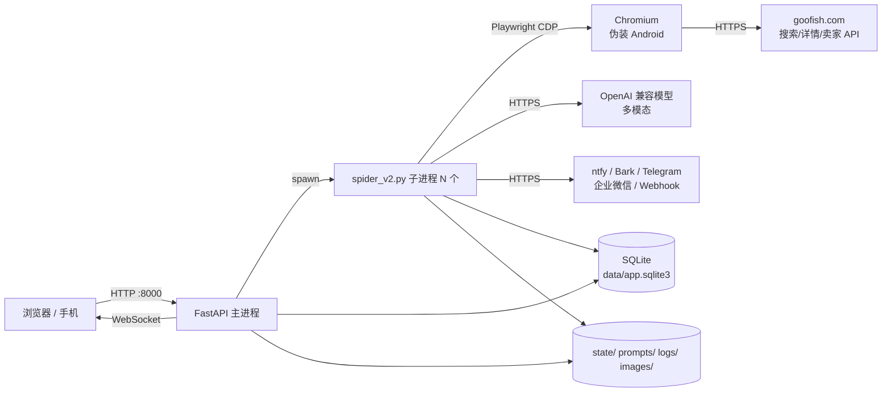
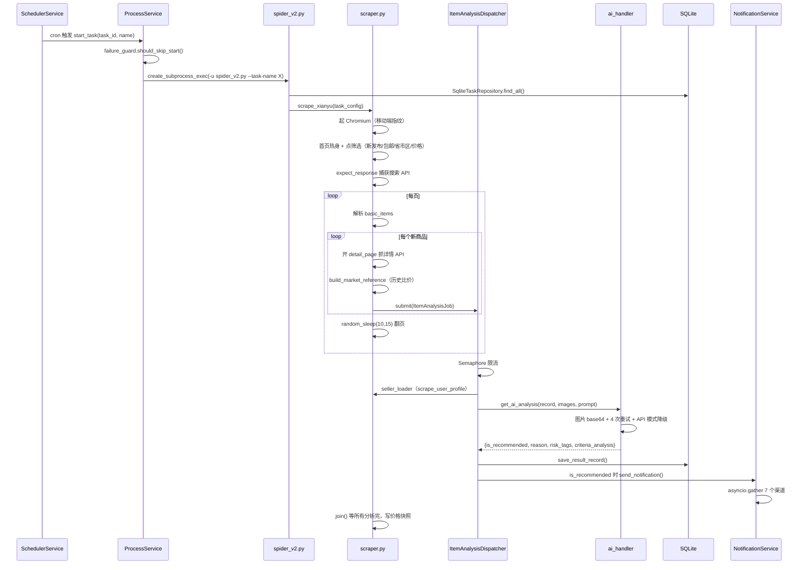

# 02 架构：一个 Web 进程 + N 个抓取子进程

## 这篇回答什么问题

- 系统边界在哪：谁是常驻进程，谁是一次性进程。
- 模块怎么分层，为什么分了四层还留着一堆「大文件」。
- 一条商品从「搜索命中」到「手机响」的完整数据流。
- 六个关键设计决策，每个的代价与替代方案。
- 读这套架构最容易误解的三点。

## 系统上下文

三个外部依赖是硬约束：闲鱼（会风控你）、模型供应商（会抽风、会不支持参数）、通知渠道（会返回业务错误）。整个架构几乎可以理解成「对这三个不可靠外部依赖的防御工程」。

## 模块地图

四层分层在 `CLAUDE.md` 里写明，代码里确实按目录执行：

| 层 | 目录 | 职责 | 代表文件 |
|---|---|---|---|
| API | `src/api/routes/` | 9 个 router，只做参数校验 + 调 service | `tasks.py`(281) `settings.py`(349) `results.py`(224) `logs.py`(203) |
| 服务 | `src/services/` | 业务编排：进程、调度、AI、通知、存储、聚合 | `process_service.py`(307) `item_analysis_dispatcher.py`(173) `result_storage_service.py`(475) `price_history_service.py`(404) |
| 领域 | `src/domain/` | Pydantic 实体 + 仓储接口 | `models/task.py`（`Task` / `TaskCreate` / `TaskUpdate`） |
| 基础设施 | `src/infrastructure/` | SQLite、配置、AI 客户端、通知客户端 | `persistence/sqlite_connection.py`(182) `config/settings.py`(148) `external/ai_client.py`(280) |

但分层并不干净，有三个「越界」需要知道，否则读代码会绕晕：

1. **`src/scraper.py`(1344) 是跨层的怪物**。它直接读 `task_config` dict、直接调 Playwright、直接构造结果记录、直接提交给 dispatcher。它不是 service，是「子进程里的一个独立应用」。
2. **`src/ai_handler.py`(479) 与 `src/infrastructure/external/ai_client.py`(280) 功能重叠**。前者是子进程用的模块级函数（依赖 `src/config.py` 的全局 `client`），后者是类封装的 `AIClient`（用于 Web 进程里的 prompt 生成）。两套并存是历史包袱。
3. **`src/config.py`(111) 是模块级副作用**：import 时就 `load_dotenv()`、就建 `AsyncOpenAI`、就 `os.makedirs("images")`（`src/config.py:10-16, 61-80`）。子进程可以这么干，Web 进程不应该。

## 数据流：一条商品的一生

关键点：**抓取与分析是流水线并行**，不是「抓完再分析」。`ItemAnalysisDispatcher.submit()` 每发现一个商品就丢一个 task 进信号量池（`src/scraper.py:1135-1155`），抓取线程继续翻页，最后 `join()` 收尾。这是它能「实时」的原因——第一件商品的 AI 分析在第二件商品还没抓完时就开始了。

## 部署拓扑

单容器单进程组：

| 进程 | 数量 | 生命周期 | 日志 |
|---|---|---|---|
| `python -m src.app`（FastAPI） | 1 | 常驻，tini 做 PID 1 | 容器 stdout |
| `python -u spider_v2.py --task-name X` | 0..N（每任务一个） | 任务启动→结束 | 重定向到 `logs/<task>.log`（`src/services/process_service.py:111-117`） |
| Chromium | 每子进程 1 个 | 随子进程 | 禁用了 crashpad（`src/scraper.py:117-134`） |

为什么抓取一定要独立进程而不是 asyncio task？三个理由都能在代码里找到：

1. **Playwright 的浏览器实例和事件循环强绑定**，一个任务卡死（等一个永远不来的响应）会拖住整个 loop。
2. **崩溃隔离**：`os.setsid` 建独立进程组（`src/services/process_service.py:107`），停止时 `os.killpg(...SIGTERM)` 能一次带走 Chromium 子进程树（`:254-278`），不会留孤儿浏览器吃内存。
3. **停止语义**：`STOP_TIMEOUT_SECONDS = 20`（`:20`）后 `SIGKILL`，Web 进程不会因为等抓取而卡住。

代价：**跨进程状态同步靠数据库 + WebSocket**，不能共享内存。所以有 `reindex_after_delete`（`:286-301`）这种把 task_id 映射平移的补丁——进程表是按 task_id 索引的，任务被删了 ID 会错位。

## 六个关键设计决策

### 1. 定时任务 = 起子进程，不是进程内执行

`src/services/scheduler_service.py:78-81`：`_run_task` 只有一行 `await self.process_service.start_task(...)`。

- 代价：cron 精度受进程启动时间影响（冷启动 2-5 秒），且无法在任务内部做细粒度取消。
- 替代：APScheduler 里直接 `await scrape_xianyu()`——会被上面三个理由否掉。
- 收获：调度器与执行器完全解耦，手动启动和定时启动走同一条路径（`POST /api/tasks/start/{task_id}` 与 cron 都进 `start_task`）。

### 2. 结果存储从 JSONL 迁到 SQLite，但保留文件语义

`result_items` 表有 `UNIQUE(result_filename, link_unique_key)`（`src/infrastructure/persistence/sqlite_connection.py:13-104`），查询按「文件名」过滤。也就是说：**表结构是关系型的，对外 API 仍是「文件」心智**（`GET /api/results/files`、`GET /api/results/{filename}`）。

- 代价：`result_filename` 是字符串外键，不是 `task_id`。改任务名会分裂数据集（`build_result_filename(keyword)` 由 keyword 派生，`src/infrastructure/persistence/storage_names.py`）。
- 收益：前端与导出不用改，旧 `jsonl/` 数据能一次性导入（`sqlite_bootstrap.py:28-41` 幂等导入）。
- 这是典型的**渐进式迁移**：先换存储，再慢慢换语义。

### 3. AI 调用带「能力探测式降级」

`src/ai_handler.py:372-468` 的重试循环里，失败不是简单重试，而是**根据错误信息切换 API 形态**：

| 失败特征 | 动作 | 位置 |
|---|---|---|
| Responses API 不支持 | 切 Chat Completions | `ai_handler.py:446-458` |
| 不支持结构化输出 | 关掉 `response_format` | `:459-463` |
| 不支持 temperature | 移除该参数 | `:464-468` |
| 任意失败 | temperature 0.1 → 0.05 | `:379` |

`src/services/ai_request_compat.py:13-35` 维护了四组错误特征串，`:178-195` 甚至兜底判定 `status_code==404 and message=="error code: 404"`——因为某家网关就是这么返回「不支持该接口」的。

- 代价：一次失败请求已经花了钱和时间。
- 收益：一套代码能吃下官方 OpenAI、各种中转网关、只支持 Chat 的国产模型、会返回 reasoning 内容的推理模型（`ai_response_parser.py:12-44` 回退 `reasoning_content`）。

### 4. 反爬不靠「更快的请求」，靠「更像人」

具体手法见 04 深挖。架构层面的取舍是：**放弃并发抓取，换取存活率**。每个商品后睡 5-10 秒（`src/scraper.py:1167`），每页后睡 10-15 秒（`:1198`）。一个 10 页 × 20 商品的任务，光睡觉就要 30 分钟以上。

- 代价：吞吐极低。
- 收益：账号活得久。配合熔断（连续 3 次失败暂停 24 小时，`src/failure_guard.py:155-357`），是「宁可慢，不可封」。

### 5. 失败熔断器是文件级、跨进程的

`FailureGuard` 把状态写在 `logs/task-failure-guard.json`，用 `fcntl.flock` 加锁（`src/failure_guard.py:90-110`，Windows 上静默跳过），原子写用 tmp+fsync+os.replace（`:136-143`），读坏 JSON 时改名 `.corrupt.<ts>` 保留现场（`:119-133`）。

- 为什么不用数据库？因为 Web 进程和子进程都要读它，而子进程可能连数据库还没初始化。文件是最低公共依赖。
- 代价：Windows 无锁，多任务并发写可能丢更新（`推断：` 概率低但存在）。
- 亮点：`:247-261` 若 cookie 文件 mtime 变新，自动解除暂停——**用户更新登录态即自动恢复**，不需要手动点按钮。

### 6. 前端是纯 SPA，后端只做静态托管 + catch-all

`src/app.py:118-185`：挂 `/static`、条件挂 `/assets`、`GET /` 返回 `dist/index.html`、catch-all 对 `.js/.css/.png` 等后缀直接 404 避免把资源请求也返回 HTML。

- 代价：`dist/` 不存在时整站 500（`:155-165`），需要先 `npm run build`。
- 收益：单一端口、无 CORS、Docker 镜像里前后端同源。

## 架构亮点

1. **响应拦截代替 DOM 解析**：`page.expect_response(is_search_results_response)` 包住 `goto`（`src/scraper.py:711-716`），直接拿闲鱼的 JSON 响应，而不是解析渲染后的 HTML。页面改版只要 API 结构不变就还能跑。
2. **CSS Module hash 前缀匹配**：`[class*='areaWrap']`、`[class*='provItem']`（`src/scraper.py:836-936`）——闲鱼前端用 CSS Modules，class 名带构建 hash 会变，但前缀稳定。
3. **头部白/黑名单过滤**：`_BROWSER_MANAGED_EXTRA_HEADERS`（`src/scraper.py:370-399`）防止用户从浏览器扩展导出的 `extra_http_headers` 里带上 `Sec-Fetch-*`、`Accept: */*` 这类 XHR 头，套到文档请求上会白屏。这是踩过坑才有的代码。
4. **卖家资料缓存的并发合并**：`SellerProfileCache.get_or_load`（`src/services/seller_profile_cache.py:44-63`）用 `_inflight` dict 保证同一 user_id 并发只加载一次，TTL 1800 秒。经典的 singleflight。
5. **AI 生成 prompt 的 job 化**：`POST /api/tasks/generate` 返回 202 + job_id（`src/api/routes/tasks.py:87-129`），`run_ai_generation_job` 分五步上报进度（`task_generation_runner.py:72-118`），失败清理半成品文件（`:116-117`）。因为生成一份标准要几十秒，同步接口必超时。
6. **思考模型的输出截断修复**：`CRITERIA_MAX_OUTPUT_TOKENS = 8192`（`src/prompt_utils.py:39`）+ 剥 `<think>` 块 + 未闭合则报错（`:40-75`）。注释直白写着「800 会截断正文」。

## 读架构最容易误解的三点

1. **「多任务并发」不是线程并发**。`max_concurrent` 之类的概念在抓取层不存在；并发只发生在 (a) 多个子进程之间，(b) 单个任务内 `ItemAnalysisDispatcher` 的 AI 分析信号量。抓取本身严格串行。
2. **「WebSocket 实时推送」只推状态**。`websocket.py:39-57` 的 `broadcast_message` 只发 `task_status_changed` 这类事件，商品数据仍走 HTTP 轮询。
3. **「账号轮换」默认关闭**。`ACCOUNT_ROTATION_ENABLED` 默认 `False`（`src/api/routes/settings.py:185-199`），只有显式开启并配了 `state/*.json` 才生效。README 把它列为核心特性，但默认路径是「单账号 + 根目录 `xianyu_state.json`」。

## 一句话记住

整个架构就一句话：**把不可靠的外部世界（闲鱼、模型、推送）关进子进程，让 Web 进程只做「调度 + 展示 + 持久化」**。
