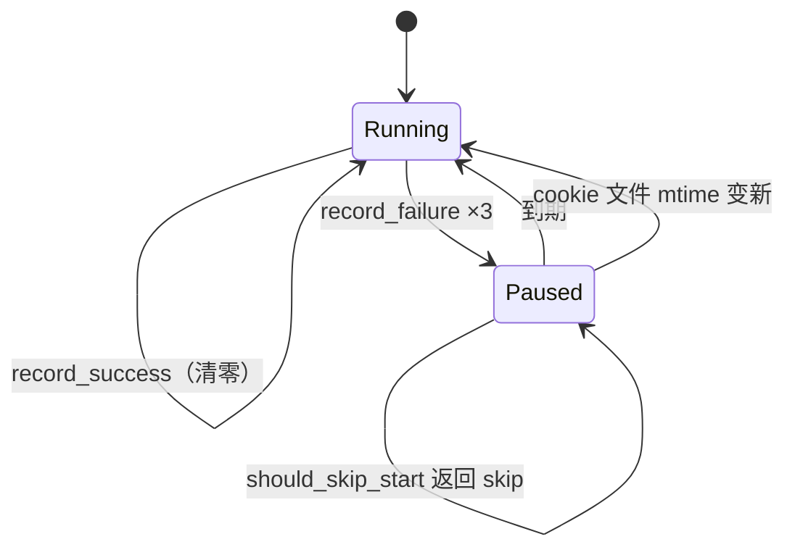

# 04 深挖：抓取-分析流水线怎么对抗一个会封你的网站

## 这篇回答什么问题

- 一个「每 5-10 秒才发一个请求」的爬虫，凭什么还能跑得动？
- 页面改版、CSS hash 变化、风控弹窗、cookie 过期——四种失效模式分别怎么防。
- 为什么风控异常**不重试**，而普通异常要换号重试。
- 熔断器为什么用文件而不是数据库，它怎么做到「用户一更新 cookie 就自动复活」。
- 哪些能偷，哪些是硬编码的权宜之计。

## 问题是什么

闲鱼（goofish.com）的搜索页有三层防御：

1. **接口签名**：搜索与详情走 `h5api.m.goofish.com` 的 mtop 接口，带 `sign` 参数，由页面里的 JS 计算（`src/config.py:22-23` 只记录了 URL 模式，签名逻辑在页面里）。
2. **指纹与行为**：webdriver 标记、UA、时区、触摸能力、请求间隔。
3. **账号级风控**：连续异常后弹验证框（`div.baxia-dialog-mask`、`div.J_MIDDLEWARE_FRAME_WIDGET`），或接口返回 `FAIL_SYS_USER_VALIDATE`。

而目标又是「实时」——晚 10 分钟发现，东西已经被人买走了。**低频率 + 实时性**是这个项目最根本的矛盾。

## 朴素做法为什么不够

| 朴素做法 | 死法 |
|---|---|
| `requests` 直接打 mtop 接口 | 签名算法在 JS 里，逆向了也会随版本变；且没有真实浏览器的 TLS/HTTP2 指纹 |
| Playwright 抓 HTML 再 CSS 选择器解析 | 闲鱼前端是 React + CSS Modules，class 名带构建 hash，一次发版全废 |
| 高频轮询（每 30 秒一次） | 账号几小时内被风控；且 `FAIL_SYS_USER_VALIDATE` 一旦出现，说明已被标记 |
| 一个浏览器实例跑所有任务 | 一个任务卡在等响应，其他任务全阻塞；Chromium 崩了全部陪葬 |

## 这个项目怎么做

### 1. 抓「响应」而不是抓「DOM」

```python
# src/scraper.py:711-716
async with page.expect_response(is_search_results_response) as resp_info:
    await page.goto(search_url, wait_until="domcontentloaded", timeout=30000)
```

`expect_response` 在 `goto` 之前注册，所以第一个搜索响应不会漏。拿到的是结构化 JSON，`src/parsers.py:8` 的 `_parse_search_results_json` 直接按字段取值。

**关键洞察**：接口结构比 DOM 结构稳定得多。DOM 是给人看的，随时改版；接口是给前端用的，改一次要同时改前端。这条选择让项目在闲鱼多次改版中活了下来。

同理，详情页也是 `expect_response(lambda r: DETAIL_API_URL_PATTERN in r.url)`（`src/scraper.py:1036-1041`）。

### 2. CSS Module hash 用「前缀包含」匹配

闲鱼的 class 长这样：`areaWrap--h3K2x`、`provItem--8sD1f`。项目用属性子串选择器：

```python
# src/scraper.py:836-936（节选）
page.locator("[class*='areaWrap']")
page.locator("[class*='provItem']")
page.locator("[class*='searchBtn']")
```

区域提交按钮的文字也会变（`查看 12 件宝贝` / `查看 999+ 件宝贝`），所以用正则：

```python
# src/scraper.py:107-113
REGION_SUBMIT_TEXT = re.compile(r"查看(?:\d+|999\+)件宝贝")
```

这是**「按语义锚定，不按字面锚定」**的典型：hash 会变，语义不会。

### 3. 移动端指纹是「一组参数」，不是一个 UA

```python
# src/scraper.py:287-299
{
  "user_agent": "Mozilla/5.0 (Linux; Android 13; Nexus 5) ... Chrome/131 ...",
  "viewport": {"width": 412, "height": 915},
  "device_scale_factor": 2.625,
  "is_mobile": True,
  "has_touch": True,
  "locale": "zh-CN",
  "timezone_id": "Asia/Shanghai",
  "geolocation": {"longitude": 121.4737, "latitude": 31.2304},  # 上海
  "permissions": ["geolocation"],
}
```

加上 `add_init_script`（`src/scraper.py:664-685`）里抹 `navigator.webdriver`、伪造 `plugins`/`languages`/`chrome`/`maxTouchPoints`/`permissions.query`。

为什么是 412×915、DPR 2.625？这是 Pixel/Nexus 5 的物理参数。UA 说自己是 Nexus 5，viewport 却是 1920×1080，等于自报「我是脚本」。**指纹的一致性比指纹本身更重要**。

### 4. 请求头的白/黑名单

从 Chrome 扩展导出的登录态里可能带 `headers`（原页面的请求头）。如果把这些头原样塞进 `extra_http_headers`，文档请求会带上 `Sec-Fetch-Dest: empty`、`Accept: */*`——浏览器会把它当 XHR 而不是导航请求，页面白屏。

```python
# src/scraper.py:370-399
_BROWSER_MANAGED_EXTRA_HEADERS = { ... }  # 黑名单：Sec-Fetch-*、Accept、Host、Cookie...
```

只放行 `User-Agent`、`Accept-Language` 这类「用户可配」的头。这个坑有专门的回归测试：`tests/unit/test_scraper_extra_headers.py`。

### 5. 商品级延迟 + 页级长休息

| 位置 | 延迟 | 代码 |
|---|---|---|
| 打开详情页前 | 2–4 秒 | `src/scraper.py:1029` |
| 商品处理完 | 5–10 秒 | `src/scraper.py:1167` |
| 关闭详情页后 | 2–4 秒 | `src/scraper.py:1191` |
| 翻页前 | 10–15 秒 | `src/scraper.py:1198` |

`random_sleep`（`src/utils.py:61-65`）用 `random.uniform`，不是固定值——固定间隔本身是机器特征。

粗算：一个 10 页 × 20 商品的任务，光睡眠 ≈ 10×(20×(3+7.5+3) + 12.5) ≈ 2800 秒 ≈ 47 分钟。**这就是「实时」的真实成本**。

### 6. 四种失效模式，四种处理

| 失效模式 | 检测点 | 处理 | 代码 |
|---|---|---|---|
| Cookie 过期 | 被重定向到 `passport` / `mini_login` | 抛 `LoginRequiredError`，**不重试** | `src/scraper.py:717-720` |
| 风控弹窗 | `div.baxia-dialog-mask` / `div.J_MIDDLEWARE_FRAME_WIDGET` | 抛 `RiskControlError`，**不重试** | `src/scraper.py:740-786` |
| 接口级验证 | 详情返回 `FAIL_SYS_USER_VALIDATE` | 随机睡 3–60 秒后抛 `RiskControlError` | `src/scraper.py:1049-1065` |
| 其他异常（超时、网络） | `except Exception` | 换号/换代理重试，最多 `attempt_limit` 次 | `src/scraper.py:1329-1341` |

**为什么不重试风控？** 代码注释直说了：

```python
# src/scraper.py:1335-1337
except RiskControlError as e:
    print(f"检测到风控或验证触发: {e}")
    # 风控验证通常不是简单轮换能解决的，避免无意义重试。
    break
```

推断：重试会加深风控标记，且换号成本高（每个号要人工导 cookie）。**这是「止损优于重试」的取舍**，与大多数爬虫框架的默认行为相反。

### 7. 去重的两级 key

```python
# src/utils.py:117-119
def get_link_unique_key(link: str) -> str:
    return link.split('&', 1)[0]     # 截到第一个 & 之前
```

为什么不全链接比对？因为闲鱼链接带一堆 tracking 参数（`spm`、`scm`、`from`），同一商品每次抓到的链接都不同。截断后剩 `https://www.goofish.com/item?id=123456`，稳定。

存储层再兜一层：`UNIQUE(result_filename, link_unique_key)`（`src/infrastructure/persistence/sqlite_connection.py:13-104`），用 `INSERT OR IGNORE` 写入（`src/services/result_storage_service.py:169-196`）。**内存去重 + 数据库唯一约束**双保险，防止重启后重复通知。

### 8. 熔断器：文件级、跨进程、可自愈

```python
# src/failure_guard.py:155-180
class FailureGuard:
    path = "logs/task-failure-guard.json"
    threshold = 3            # 连续失败 3 次
    pause_seconds = 86400    # 暂停 24 小时
    tz_name = "Asia/Shanghai"
```

状态机：



三个工程细节值得抄：

**a. 文件锁 + 原子写**

```python
# src/failure_guard.py:90-110（_FileLock 用 fcntl.flock）
# src/failure_guard.py:136-143（_atomic_write_json: tmp + fsync + os.replace）
```

Web 进程和子进程同时读写这个文件。用 flock 串行化，用 `os.replace` 保证读者永远看到完整 JSON。Windows 上 flock 不可用，代码静默跳过——`推断：` 单机单用户场景下冲突概率低，可接受。

**b. 坏文件保留现场**

```python
# src/failure_guard.py:119-133
# 解析失败 → 改名 task-failure-guard.json.corrupt.<ts>，然后返回空结构
```

不是删掉重建，而是留证据。排查「为什么任务被暂停了」时这是唯一线索。

**c. cookie 变更即自愈**

```python
# src/failure_guard.py:247-261
if (paused_until and paused_until > current
        and cookie_path and _cookie_changed(cookie_path, previous_cookie_mtime)):
    self.record_success(task_key, now=current)
    return SkipDecision(skip=False, reason="cookie_updated", ...)
```

**这是整个项目最漂亮的一处设计**：熔断的根因是「登录态失效」，那么用户更新登录态就等于修好了根因。不需要「重置熔断」按钮，不需要重启服务，只要把新的 cookie 文件覆盖上去，下次调度自动恢复。

### 9. 账号/代理轮换池

```python
# src/rotation.py:14-43
class RotationPool:
    _blacklist: Dict[str, float]   # value -> 到期时间戳
    def pick_random(self): ...      # 只从非黑名单里选
    def mark_bad(self, item, reason): ...  # 写 TTL
```

黑名单是**惰性清理**（`_cleanup_blacklist` 在每次 `available_items` 时顺手清过期项），不是定时器。这是省一个后台任务的小技巧。

两种轮换模式（`src/scraper.py:222-272`）：

| 模式 | 行为 | 适用 |
|---|---|---|
| `per_task` | 一个任务全程用一个号/一个 IP | 账号多、想摊平风险 |
| `on_failure` | 首次用默认，失败后 `mark_bad` + 换新 | 账号少、优先保证任务完成 |

## 复杂度/性能/边界

| 维度 | 值 | 依据 |
|---|---|---|
| 单任务吞吐 | ≈ 20 商品/页 × 10 页，实际 40-60 分钟 | 由睡眠常量推算 |
| 并发抓取 | **1**（严格串行） | 无并发抓取代码 |
| 并发分析 | 默认 **2**，可用任务级 `ai_analysis_concurrency` 或环境变量 `AI_ANALYSIS_CONCURRENCY` 覆盖 | `src/scraper.py:275-278`、`src/services/item_analysis_dispatcher.py:35-66` |
| 内存 | 每子进程 1 个 Chromium ≈ 200-400 MB | 推断：常规 Chromium 占用 |
| 卖家资料缓存 | TTL 1800 秒，singleflight | `src/services/seller_profile_cache.py:22-30` |

边界条件：

- `max_pages` 到顶或 `debug_limit` 触发时 `stop_scraping = True`（`src/scraper.py:1013-1015`）。
- 页面加载超时（25 秒）会跳过该商品，不影响后续（`src/scraper.py:1183-1185`）。
- 所有商品抓完后在 `finally` 里 `await dispatcher.join()`（`src/scraper.py:1221-1223`），保证没有分析被丢弃。
- 图片在分析完成后立即删除（`item_analysis_dispatcher.py:143-144`），避免 `images/` 无限增长。

## 取舍与局限

1. **吞吐换存活率**。47 分钟扫完 200 个商品，热门商品早就没了。这是有意的，但意味着它**不适合抢秒杀**，只适合「持续盯盘」。
2. **反爬手段会被淘汰**。抹 webdriver、伪造 plugins 都是已知套路，闲鱼升级检测就失效。项目没有「自动适配新反爬」的能力，只能靠人改代码。
3. **区域筛选数据是快照**。`web-ui/src/data/goofishRegions.json` 内置省市区，闲鱼调整行政区划就过期。
4. **风控不重试 = 任务直接失败**。一次误判就浪费一整轮，且要等 24 小时（或被 cookie 更新救回）。
5. **`FAIL_SYS_USER_VALIDATE` 后睡 3-60 秒再抛异常**——这个延迟意义不大（推断：只是避免「检测到就立刻退出」的行为特征），但会让日志看起来莫名其妙。

## 我能偷什么

| 想法 | 怎么用到我的项目 |
|---|---|
| 抓响应不抓 DOM | 任何有 XHR 的站点，优先 `expect_response`；DOM 解析只做兜底 |
| 前缀匹配对抗 hash class | 前端构建产物里的 class 名一律用 `[class*='语义前缀']` 而非全名 |
| 指纹一致性 | 伪装浏览器时，UA / viewport / DPR / touch 必须来自同一台真实设备 |
| 白名单式请求头透传 | 用户提供的 header 只放行白名单，`Sec-Fetch-*` / `Host` / `Cookie` 一律由浏览器管 |
| 风控不重试 | 区分「可恢复错误」与「策略性错误」，后者立即止损并告警 |
| cookie 变更自愈熔断 | 熔断条件若绑定某个外部凭据，就让「凭据更新」成为解除条件 |
| 坏文件改名不删除 | 任何状态文件解析失败都留 `.corrupt.<ts>`，排查靠它 |
| 内存去重 + DB 唯一约束 | 去重 key 两端都设，防止重启/并发漏网 |

## 一句话记住

它对抗风控的全部哲学是：**降低单位时间的信息获取量，把省下来的「可疑度」换成更长的存活时间，并且用「语义锚点」而不是「字面锚点」去对抗页面改版**。
