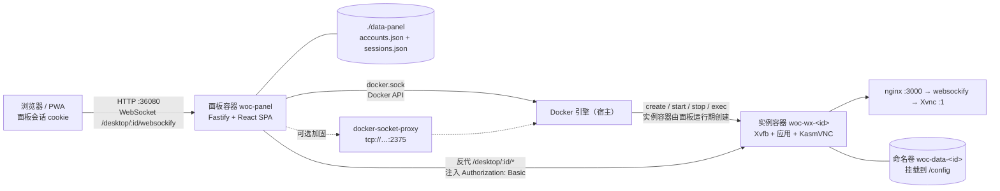
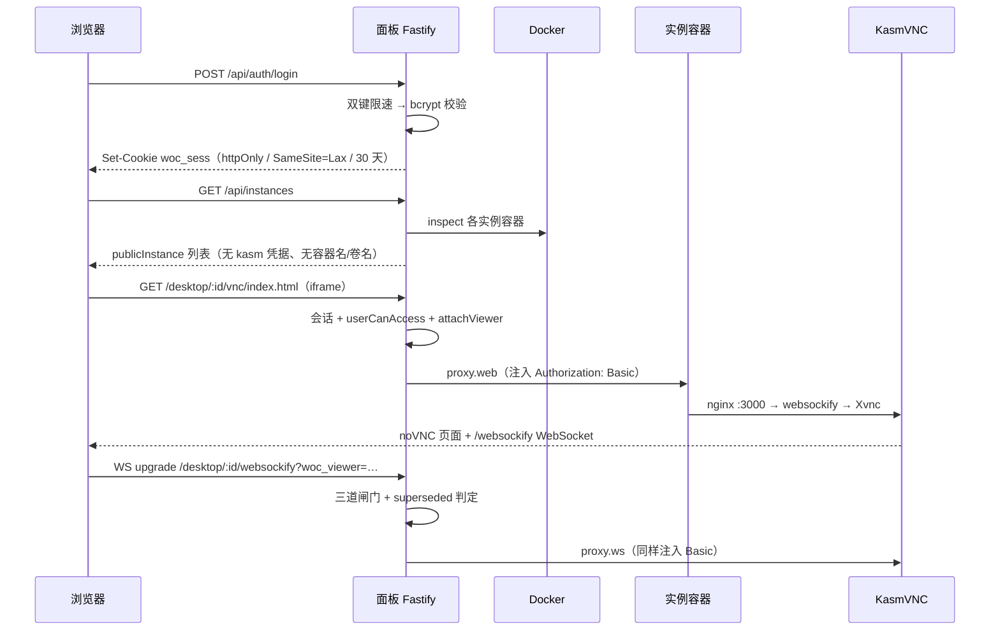

# 02 架构：两个容器类、三条链路、一个门卫

> 这篇回答什么问题：WOC 由哪些进程和容器组成？一次「打开桌面」的数据怎么流？哪些设计是刻意取舍、代价是什么？读代码时最容易误解哪几处？

## 系统上下文



三条链路要分清，它们失败时表现完全不同：

1. **控制链路**：浏览器 → 面板 HTTP API → docker.sock → 实例容器生命周期。
2. **显示链路**：浏览器 → 面板反代 → 实例 nginx → websockify → Xvnc。
3. **数据链路**：面板 `exec` 进实例（文件、剪贴板、应用安装状态）或直接读写命名卷。

## 模块表

| 模块 | 位置 | 职责 | 关键证据 |
|---|---|---|---|
| Web SPA | `panel/web/src/` | 登录、实例卡片、管理页、内嵌 noVNC iframe、输入桥、音频 | `panel/web/src/App.tsx:1-47`；`panel/web/src/pages/Desktop.tsx:14-19`（desktopUrl） |
| HTTP/WS 入口 | `panel/server/src/index.ts`（2192 行） | 路由、鉴权、RBAC、反代、WS 升级、watchdog、诊断包 | `index.ts:130-174`（常量与两道 onRequest 闸门）；`index.ts:1947-2035`（upgrade） |
| 容器编排 | `panel/server/src/docker.ts`（2702 行） | 建卷、建容器、启停、升级、exec、日志、剪贴板、诊断 | `docker.ts:740-842`（runInstance）；`docker.ts:880-926`（upgradeInstance） |
| 持久化 | `panel/server/src/store.ts`（459 行） | 账号、实例元数据、原子写 accounts.json | `store.ts:82-92`（persist）；`store.ts:340-361`（createInstance） |
| 会话 | `panel/server/src/sessions.ts`（96 行） | 30 天滑动会话，持久化 sessions.json | `sessions.ts:12-17`；`sessions.ts:71-79` |
| Host 防护 | `panel/server/src/host-guard.ts`（140 行） | DNS rebinding 白名单、私网/CGNAT 判定 | `host-guard.ts:121-139` |
| 自更新 | `panel/server/src/self-update.ts`（282 行） | helper 容器重建面板、等待稳定、失败回滚 | `self-update.ts:187-223`；`self-update.ts:259-281` |
| 流式 I/O | `panel/server/src/upload.ts` + `tar.ts` | 上传 spool、tar 编解码 | `upload.ts:57-102`；`tar.ts:1-3` |
| 诊断 | `panel/server/src/crash-diag.ts`（436 行） | minidump 元数据解析、x86-64 微架构级别 | `crash-diag.ts:1-16` |
| 实例镜像 | `docker/` | Xvfb/KasmVNC、应用启动、输入法补丁、身份伪装 | `docker/Dockerfile:4-20`；`Dockerfile:124-148` |
| 部署 | `docker-compose.yml` / `docker-compose.secure.yml` | 面板容器、数据卷、docker.sock、日志上限 | `docker-compose.yml:58-79` |

## 主数据流：从登录到看见桌面



证据链：登录与限速 `index.ts:245-334`；列表只下发 `publicInstance` `index.ts:494-511`；凭据注入 `index.ts:1789-1796`；WS 三道闸门 `index.ts:1947-2035`；实例目标 `docker.ts:2698-2700`。

## 部署拓扑

| 层 | 内容 | 说明 |
|---|---|---|
| 接入层 | 可选 HTTPS 反代（Caddy / Nginx / 飞牛内置） | 面板自身只跑 HTTP；TLS 由外层终止（`README.md:192`） |
| 面板层 | `woc-panel` 单容器 | 挂 `./data-panel:/data`、`/var/run/docker.sock`、可选 `/dev:/host-dev:ro`（`docker-compose.yml:58-66`） |
| 实例层 | `woc-wx-<id>` 多容器 | 每实例独立命名卷；只接实例专用网络 `woc-instances`；不映射任何宿主端口 |
| 数据层 | 命名卷或宿主目录 | `WOC_DATA_ROOT` 可把新实例落到宿主绝对路径（`docker.ts:645-700`） |

加固部署插一个 `tecnativa/docker-socket-proxy`，面板改连 `tcp://docker-socket-proxy:2375`，并把裸 socket 覆盖成 `/dev/null`（`docker-compose.secure.yml:12-45`、`50-55`）。

## 实例容器内部长什么样

面板只是外壳，真正让「微信出现在浏览器里」的是实例镜像。它的进程树与启动顺序值得单独看一遍，否则会误以为面板在做重活。

```text
s6-overlay（baseimage-kasmvnc 自带）
├── /custom-cont-init.d/00-woc-identity      ← machine-id + OS 伪装（woc-identity.sh）
├── /custom-cont-init.d/01-woc-autostart     ← 每次启动覆盖数据卷里的 autostart
├── /custom-cont-init.d/02-woc-app           ← 写 /config/.woc-app（应用类型）
├── Xvnc :1（KasmVNC 1.5.2，-NeverShared -DLP_ClipTypes text/html）
├── nginx :3000（KasmVNC 自带，Basic 由面板注入）
├── websockify → Xvnc
└── openbox（/defaults/autostart）
    ├── xsettingsd（Xft/DPI 98304）
    ├── 壁纸看守（每 2s 用「壁纸名+分辨率」签名重设 xwallpaper --zoom）
    ├── 防最小化看守（每 2s 把不可见顶层窗口 windowactivate）
    └── while true: 拉起 ${APP_LAUNCH}，退出 2s 后重启
```

四个 `custom-cont-init.d` 钩子是理解「为什么升级镜像能修好旧数据卷」的关键：

| 钩子 | 做什么 | 为什么必须每次跑 |
|---|---|---|
| `00-woc-identity` | 生成/复用 `/config/.woc-machine-id`，写回 `/etc/machine-id` 与 `/var/lib/dbus/machine-id`；`WOC_SPOOF_OS=1` 时把 `/etc/os-release` 改成 deepin 23 | 全世界实例共用镜像里烤死的同一 machine-id 是典型「设备农场」特征（`woc-identity.sh:4-15`） |
| `01-woc-autostart` | `cp /defaults/autostart /config/.config/openbox/autostart` | baseimage 只在文件缺失时拷贝，旧卷会一直跑旧逻辑（`woc-update-autostart:1-14`） |
| `02-woc-app` | 按 `WOC_APP_TYPE` 写 `/config/.woc-app`，白名单五种类型 | 应用类型是实例属性，必须每次从 env 同步（`woc-app-init.sh:14-24`） |
| `03-woc-xlock`（仅未合并分支有） | 删 `/tmp/.X[0-9]*-lock` 与对应 socket | 强杀 Docker 后锁里的 pid 可能被 nginx/s6 复用，Xvnc 认定显示被占用而拒起 |

`autostart` 里那几个「看守」循环是纯粹的工程妥协，值得单独理解：

- **壁纸看守**：KasmVNC 在浏览器 resize 后会重设 X 分辨率，`xwallpaper` 只在启动时设一次，于是画面被 2×2 平铺。修法是每 2 秒用「壁纸名 + 当前分辨率」拼一个签名，签名变了才重设（`autostart:62-78`）。
- **防最小化看守**：微信被最小化后画面就静止，用户以为卡死。修法是每 2 秒检查不可见顶层窗口并 `windowactivate`（`autostart:33-42`）。
- **xsettingsd 的 `Xft/DPI 98304`**：98304 = 96 × 1024。误写成 96 会让 Chromium 的缩放因子接近 0，GPU 进程连续崩溃、最终黑屏——这是 v1.2.9~v1.3.1 的总根因 issue #111（`autostart:148-170`、`docker.ts:2566-2671`）。

## 关键设计决策

| 问题 | 方案 | 代价 | 被否决的替代 |
|---|---|---|---|
| 多人怎么共享一个微信？ | 共享同一块远程桌面、同一个进程 | 无租户隔离，一个人操作所有人可见 | 每用户一个实例（要多个微信号，内存 ×N） |
| 容器还是 VM？ | 容器 + Xvfb + KasmVNC | 共享内核；实例 `seccomp=unconfined`（`docker.ts:777`） | VM + 远程桌面，重且慢 |
| KasmVNC 凭据怎么给？ | 服务端注入 Basic，前端永不接触 | 多一跳反代，反代故障即黑屏 | 把凭据写进 iframe URL（会进浏览器历史/日志） |
| 微信打进镜像吗？ | 不打，首次用时下到 `/config/wechat` | 首次使用依赖腾讯 CDN | 烤进镜像（镜像巨大、更新要重发） |
| 允许多条桌面连接吗？ | 单连接，新页面接管旧页面 | 同一时刻只有一处能操作 | `-AlwaysShared`（EncCache 泄漏，`Dockerfile:138-141`） |
| 长任务怎么处理？ | 立即返回 + 后台执行 + 轮询 | 前端状态机复杂 | 同步等待（被反代 60s 掐断，`index.ts:518-525` 注释） |
| 重建容器怎么配？ | 声明式 createOpts，绝不克隆旧容器 | 必须显式枚举每个字段 | inspect 旧容器克隆（会带过期 Hostname，`self-update.ts:111-113`） |
| docker.sock 怎么保护？ | 默认裸挂；另给 socket-proxy 模板 | 默认部署 = 宿主 root | 完全不用 docker.sock（就失去编排能力） |

## 架构亮点（带证据）

1. **实例专用网络 + 面板自保**。面板建 `woc-instances` 网络并以 `GwPriority:-1` 接入，不抢默认网关（`docker.ts:222-247`）；`isFromInstanceNetwork` 用 CIDR 位运算判断来源并**排除网关**（因为经宿主转发的请求源是网关，`docker.ts:251-261`）；面板 `onRequest` 直接 403 来自该网段的请求（`index.ts:150-155`）。边界落在网络层，不依赖实例自律。
2. **凭据只在服务端**。`kasmUser/kasmPassword` 存在实例记录里，注释写明「服务端注入反代，永不下发前端」（`store.ts:50-51`）；`publicInstance` 只暴露 id/name/appType/icon/createdAt/createdBy/内存阈值，**连 containerName/volumeName 都不给**（`store.ts:257-268`）。
3. **单连接状态机**。每个页面加载时生成 viewer 标识，新页面连上时 `attachViewer` 把旧页面记为 superseded、`destroy` 旧 socket，并把控制权转给新页面（`index.ts:1122-1141`）；被接管页面的自动重连在 upgrade 阶段直接 409（`index.ts:1999-2014`）。实例侧再用 `-NeverShared` 兜一层（`Dockerfile:138-148`）。
4. **恢复不换版**。重启、自愈、卡死重启一律 `runInstance(inst, { keepImage: true })`（`docker.ts:753`），只有显式升级才换镜像（`docker.ts:880-926`）。这条是 v1.3.0 事故（看门狗把没点升级的实例换到坏镜像）写成的守则 R10。
5. **先备镜像，再删旧容器**。`runInstanceNow` 的顺序是 `ensureImage` → `snapshotContainerLog` → 删旧 → 建新（`docker.ts:753-763`）；拉不到镜像就停在第一步，旧容器还在。
6. **资源有界**。每实例强制 `LogConfig json-file 20m×2`（`docker.ts:780-782`）、面板日志单文件 512KB / 保留 365 天（`logs.ts:12-14`）、上传走流式 spool + 256MiB 预留（`upload.ts:1-7`、`57-102`）、诊断包对崩溃转储只读元数据不读内存（`crash-diag.ts:9-16`）。
7. **用真实请求判卡死**。25 秒内上游既没回响应也没回 101 才算一次 hang，快速失败不计数；10 分钟 2 次、运行满 3 分钟、15 分钟冷却外才重启（`index.ts:1738-1787`）。比另起一套健康探测更贴近用户实际路径。

## 易误解点

| 误解 | 实际 |
|---|---|
| 面板无状态，随便重建 | 面板存账号、会话、实例元数据；`accounts.json` 丢了账号和实例登记就没了，但实例容器与卷还在（`store.ts:82-92`） |
| 删实例就删聊天记录 | 默认只删容器，卷保留；`?purge=1` 才删卷，且绑定型卷会再进辅助容器 `rm -rf` 宿主目录（`index.ts:756-773`、`docker.ts:704-720`） |
| 更新面板 = 更新微信 | 两个镜像、两个生命周期；实例要显式「升级实例」（`docker.ts:880-926`） |
| 多端共享 = 消息同步 | 是同一块桌面、同一个微信进程，不是协议级同步 |
| 有子账号就有隔离 | 子账号只是面板访问权限；同一实例的所有授权用户共享同一个微信 |
| 面板绑 0.0.0.0 就是公开 | 默认拒绝非 loopback/私网/CGNAT 的 Host（`host-guard.ts:35-61`），必须显式配 `PANEL_ALLOWED_HOSTS` |
| 仓库有测试套件 | 没有。质量靠 `tsc --noEmit` + 发布门禁里的容器探针（`doc/dev/发布门禁.md`） |

## 一句话记住

WOC 的架构核心不是「微信」，而是**把容器当进程、把 docker.sock 当调度器、把 KasmVNC 当显示器、把面板当唯一门卫**——门卫之外，一切信任都建立在「实例碰不到面板」这一条网络规则上。
