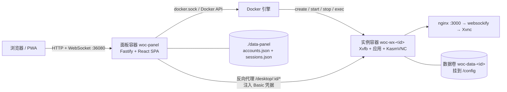
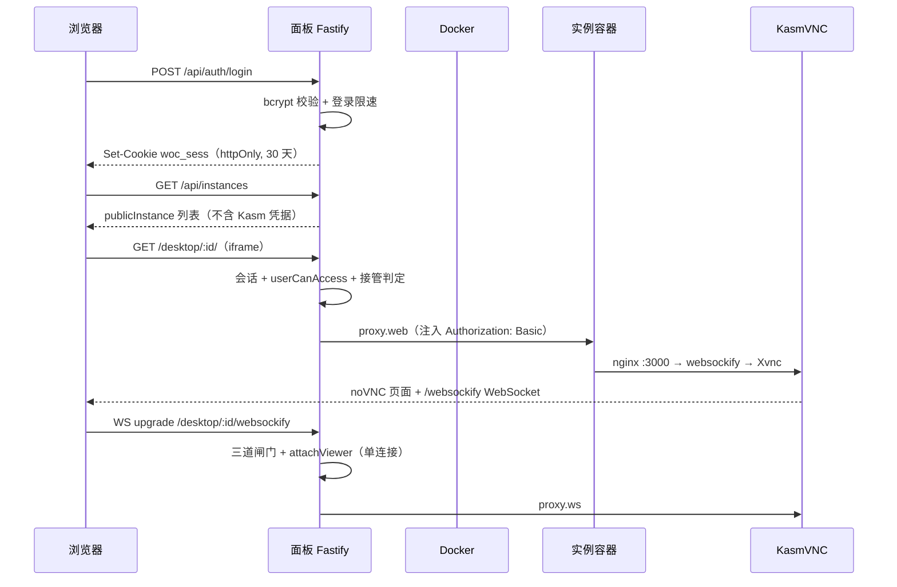

# 02 架构：面板、实例与那块共享桌面

> 这篇回答什么问题：WOC 由哪些进程/容器组成？一次「打开桌面」的数据怎么流？哪些设计是刻意的取舍，代价是什么？

## 系统上下文

关键点：**宿主只暴露面板端口**，实例不映射任何宿主端口，只能经面板反代访问（`docker-compose.yml:68-69`；`panel/server/src/docker.ts:813` 只 Expose 3000，不 Publish）。

## 模块表

| 模块 | 位置 | 职责 | 关键证据 |
|---|---|---|---|
| Web SPA | `panel/web/src/` | 登录、实例列表、管理页、内嵌桌面、输入桥、音频 | `panel/web/src/App.tsx:1-43`；`panel/web/src/pages/Desktop.tsx:543-662` |
| HTTP/WS 入口 | `panel/server/src/index.ts` | Fastify 路由、会话鉴权、RBAC、反代、WebSocket 升级、看门狗 | `panel/server/src/index.ts:130-174`；`panel/server/src/index.ts:1947-2036` |
| 容器编排 | `panel/server/src/docker.ts` | 建卷、建容器、启停、升级、exec、日志、诊断、剪贴板 | `panel/server/src/docker.ts:746-842`；`panel/server/src/docker.ts:868-926` |
| 持久化 | `panel/server/src/store.ts` | 账号、实例元数据、密码哈希，原子写 accounts.json | `panel/server/src/store.ts:82-92`；`panel/server/src/store.ts:332-372` |
| 会话 | `panel/server/src/sessions.ts` | 30 天滑动会话，持久化 sessions.json | `panel/server/src/sessions.ts:12-17`；`panel/server/src/sessions.ts:62-80` |
| Host 防护 | `panel/server/src/host-guard.ts` | DNS-rebinding 白名单、私网判定 | `panel/server/src/host-guard.ts:97-140` |
| 自更新 | `panel/server/src/self-update.ts` | helper 容器重建面板、健康检查、失败回滚 | `panel/server/src/self-update.ts:151-281` |
| 实例镜像 | `docker/` | Xvfb/KasmVNC、微信/QQ/Chromium 启动、输入法补丁 | `docker/Dockerfile:4-20`；`docker/Dockerfile:143-148` |
| 部署 | `docker-compose.yml` | 面板容器、数据卷、docker.sock、日志上限 | `docker-compose.yml:58-79` |

## 主数据流：从登录到看见桌面

证据链：登录 `panel/server/src/index.ts:302-334`；列表只下发 `publicInstance` `panel/server/src/index.ts:494-511`；反代注入 Basic `panel/server/src/index.ts:1789-1798`；WS 三道闸门 `panel/server/src/index.ts:1947-2036`；实例目标 `panel/server/src/docker.ts:2698-2700`。

## 部署拓扑

| 层 | 内容 | 说明 |
|---|---|---|
| 接入层 | 可选 HTTPS 反代（Caddy/Nginx/飞牛） | 面板自身只跑 HTTP；TLS 由外层负责，README 明确建议套反代 `README.md:192` |
| 面板层 | `woc-panel` 单容器 | 挂 `./data-panel:/data`、`/var/run/docker.sock`、可选 `/dev:/host-dev:ro`（`docker-compose.yml:58-66`） |
| 实例层 | `woc-wx-<id>` 多容器 | 每个实例独立命名卷 `woc-data-<id>:/config`；只接实例网络 `woc-instances`（`panel/server/src/docker.ts:775-776`；`panel/server/src/docker.ts:157`） |
| 数据层 | 命名卷或宿主目录 | `WOC_DATA_ROOT` 可把新实例落到宿主绝对路径（`panel/server/src/docker.ts:645-655`） |

加固部署可加 `docker-socket-proxy`，面板改连 `tcp://docker-socket-proxy:2375`，并把裸 socket 覆盖成 `/dev/null`（`docker-compose.secure.yml:12-28`；`docker-compose.secure.yml:50-55`）。

## 关键设计决策

| 问题 | 方案 | 代价 | 替代方案 |
|---|---|---|---|
| 多人怎么共享一个微信？ | 共享同一块远程桌面（同会话、同输入流） | 无租户隔离，一个人操作所有人可见 | 每用户一个微信实例（要多个微信号，资源×N） |
| 用容器还是 VM？ | 容器 + Xvfb + KasmVNC | 共享内核；实例用 `seccomp=unconfined`（`panel/server/src/docker.ts:777`） | VM + 局部远程桌面，重且慢（`doc/技术方案.md:23-29`） |
| KasmVNC 凭据怎么给？ | 面板服务端注入 Basic，前端永远拿不到 | 多一跳反代，反代故障即黑屏 | 直接暴露 KasmVNC 端口（凭据会进浏览器） |
| 镜像里带微信吗？ | 不带，首次用时下载约 190–210MB 到数据卷 | 首次使用依赖网络与腾讯 CDN | 烤进镜像（镜像大、版本难更新） |
| 允许多条桌面连接吗？ | 单连接，新页面接管旧页面 | 同一时间只有一处能操作 | 多连接（KasmVNC EncCache 泄漏，见 `docker/Dockerfile:138-141`） |
| 长任务怎么处理？ | 立即返回 + 后台执行 + 轮询 | 前端状态机复杂 | 同步等待（会被反代 60s 掐断，见 `doc/dev/架构守则.md:32-36`） |
| 重建容器怎么配？ | 声明式 createOpts，绝不克隆旧容器 | 必须显式枚举所有字段 | inspect 旧容器克隆（会复制过期 Hostname，见 `doc/dev/架构守则.md:16-20`） |
| docker.sock 怎么保护？ | 默认裸挂；提供 socket-proxy 加固模板 | 默认部署=宿主 root | 完全不用 docker.sock（就失去实例编排能力） |

## 架构亮点（带证据）

1. **实例专用网络 + 面板自保**：面板建 `woc-instances` 网络并以 `GwPriority=-1` 接入，不当默认网关；实例只接这个网络，且面板拒绝来自实例网段的请求——即使实例被攻破也访问不到面板 API。`panel/server/src/docker.ts:222-247`、`panel/server/src/docker.ts:296-321`、`panel/server/src/index.ts:149-155`。
2. **凭据只在服务端**：`kasmUser/kasmPassword` 存于实例记录，注释明确「服务端注入反代，永不下发前端」（`panel/server/src/store.ts:50-51`）；`publicInstance` 剔除这两个字段（`panel/server/src/store.ts:257-268`）。
3. **单连接状态机**：每个页面有 viewer 标识，新页面连上时旧页面标记 superseded 并断 socket；被接管页面的自动重连被 409 拒绝，只有用户点击才整页重载抢回（`panel/server/src/index.ts:1085-1141`、`panel/server/src/index.ts:2000-2013`）。
4. **恢复操作幂等**：重启/自愈一律 `runInstance(inst, { keepImage: true })`，绝不因本地 `:latest` 更新而隐式换版；升级才换镜像（`panel/server/src/docker.ts:749-753`、`panel/server/src/index.ts:1767`）。
5. **资源有界**：每个实例容器强制 `LogConfig` 20m×2（`panel/server/src/docker.ts:780-782`）；日志单文件 512KB、保留 365 天（`panel/server/src/logs.ts:12-14`）；上传走流式 spool（`panel/server/src/upload.ts:1-7`）。
6. **真实请求判卡死**：25 秒无任何响应才算一次 hang，10 分钟 2 次且运行满 3 分钟才重启（`panel/server/src/index.ts:1738-1773`）。避免把「刚启动的快速失败」误判为卡死。
7. **版本耦合 + 兜底**：正式版面板把实例镜像 `:latest` 改写为同版本 tag，避免旧面板×新实例；registry 404 时回退 `:latest`（`panel/server/src/docker.ts:17-70`）。

## 易误解点

| 误解 | 实际 |
|---|---|
| 面板是无状态的，随便重建 | 面板存账号、会话、实例元数据；`accounts.json` 丢了就要重建账号（`panel/server/src/store.ts:82-92`） |
| 删除实例会删聊天记录 | 默认只删容器，卷保留；`purge=1` 才删卷（`panel/server/src/index.ts:756-773`） |
| 更新面板 = 更新微信实例 | 两个镜像、两个生命周期；需显式「升级实例」（`doc/dev/稳定性设计.md:82-84`） |
| 多端共享=消息同步 | 是同一块桌面/同一个微信进程，不是协议同步 |
| 有子账号就有隔离 | 子账号只是面板访问权限；同一实例的所有授权用户共享同一微信 |
| 仓库有测试套件 | 没有。质量靠 `tsc --noEmit` + 发布门禁里的容器探针（`doc/dev/发布门禁.md:18-67`） |

## 一句话记住

WOC 的架构核心不是「微信」，是**一个把容器当进程、把 docker.sock 当调度器、把 KasmVNC 当显示器、把面板当唯一门卫**的服务端桌面系统。
