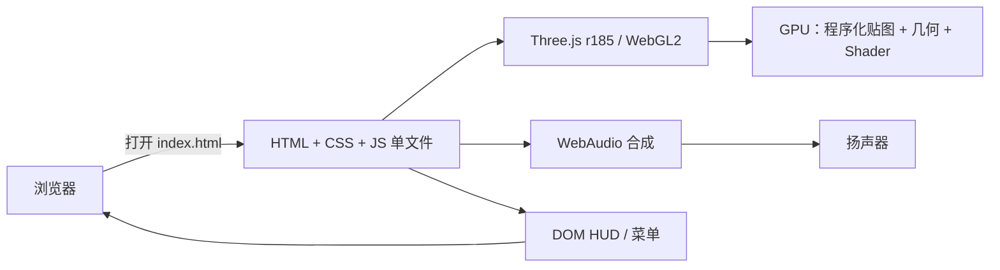

# 02 架构：模块、数据流、取舍

> 这篇回答：系统由什么组成、数据怎么流、为什么这样拆。

## 系统上下文

这是一个**单进程、单页面、无后端**的系统：浏览器打开 `index.html`，HTML/CSS 提供 HUD 与菜单，JavaScript 内嵌 Three.js r185 与游戏代码，WebGL2 负责渲染，WebAudio 负责音效。运行时不发网络请求，也没有资源文件。



## 模块地图

| 模块 | 职责 | 关键入口 |
|---|---|---|
| 启动/装配 | 按顺序初始化各模块、更新进度条、捕获错误 | `QC` `index.html:6202` |
| 渲染器 | WebGLRenderer、阴影、动态分辨率、后处理链 | `Hg` `index.html:4744`；`jy` `index.html:4743` |
| 材质工厂 | 运行时烘焙 29 个 texture set × 3 张图；48 个材质预设 | `Gg` `index.html:5453`；`c3`/`l1` `index.html:5294` |
| 材质 Shader | 噪声、FBM、Voronoi、划痕、锈蚀、掉漆等表面函数 | `e3` `index.html:4744`；`Tn` `index.html:4833-5280` |
| 关卡 | 港口布局、3 个中继、42 个出生点、55 个掩体点、12 个机位 | `C1`/`ob` `index.html:5453` |
| 背景/地面 | 天空、海面、码头、水洼、车道线、平面反射 | `pv`/`Rb`/`Cb`/`Pb` `index.html:5474`；`O1` `index.html:5825` |
| 特效 | 粒子、贴花、弹着、爆炸、雨 | `Cf` `index.html:5939`；`l3` `index.html:5294` |
| 音频 | WebAudio 预渲染 PCM、按空闲时间片合成 | `u_` `index.html:5939` |
| 玩家 | 移动、跳跃、蹲伏、冲刺、镜头、坠落/落水 | `x_` `index.html:5939`；`Mt` 同文件 |
| 战斗/武器 | 射线命中、伤害、后坐力、换弹、viewmodel | `zv` `index.html:5939`；`dm` `index.html:6065` |
| 敌人 | 飞鸥/猎犬感知、状态机、token 协调、四足 IK | `Em` `index.html:6065`；`Ui` 常量同文件 |
| HUD/游戏流程 | 准星、血量、任务、波次、结算、暂停 | `hM` `index.html:6087`；`mM` `index.html:6202` |

## 主数据流

1. **启动**：`QC`（`index.html:6202`）依次调用 `render → mats（同时创建 physics/props/input）→ level → backdrop → ground → fx → audio → player → combat → weapon → enemies → hud → game`，每步 `Nr()` 推进进度条。
2. **材质烘焙**：`Gg`（`index.html:5453`）在 GPU 上为每个 texture set 渲染 albedo/ORM/height 三张 MRT，再用 `i3`（`index.html:5280`）从高度图生成 normal；结果缓存进 `Map`，材质实例共享。
3. **关卡构建**：`C1`（`index.html:5453`）用 `ob` 的 box/slab/cyl/tube 等原语和 36 种道具原型搭出三个区域；同时生成 AABB 碰撞盒与导航网格。
4. **每帧**：输入 → `x_` 玩家胶囊移动（`d3` 的 `moveCapsule`）→ 武器射击 `zv` → 敌人 `Em` 感知/寻路/攻击 → `hM` 更新 HUD。
5. **渲染**：`Hg` 先画场景与阴影，再走 `jy` 的 depth/AO/体积光/bloom/motion blur/grade 链，最后输出到 canvas。

## 部署/进程拓扑

```text
单浏览器标签页
└─ index.html
   ├─ DOM/CSS（HUD、菜单、设置）
   ├─ JS 单 Realm
   │  ├─ Three.js r185（渲染/数学/场景图）
   │  ├─ 游戏模块（材质、关卡、玩家、敌人、武器、音频）
   │  └─ WebAudio（PCM 缓冲）
   └─ WebGL2 Context + GPU（纹理/几何/Shader）
```

没有服务器、数据库、端口、环境变量或构建产物；部署就是把这个 HTML 放到任意静态文件服务器（或直接本地打开）。

## 关键设计决策

### 决策 1：单 HTML 交付，而不是“库 + 资源包”

- **问题**：怎么让一个 3D FPS 最容易分发？
- **方案**：把 Three.js、CSS、游戏代码全部塞进一个 `<script>`；不引用任何外部资源。
- **代价**：首屏要解析 1.4 MB 文本；无法利用浏览器对独立资源的并行缓存；更新任何一行都要整文件重下。
- **替代方案**：Three.js 走 CDN + glTF/贴图外链；体积更小、缓存更好，但失去“单文件”卖点。

### 决策 2：运行时 GPU 烘焙贴图，而不是内嵌图片

- **问题**：PBR 场景需要大量表面细节，但图片会迅速把体积撑大。
- **方案**：用 27 个 GLSL 表面函数 + 29 个 texture set 参数，在启动时渲染成 albedo/ORM/height，再生成 normal（`index.html:5453`、`index.html:5294`）。
- **代价**：启动时占用 GPU/内存；纹理分辨率受限；图案是程序化的，缺少真实扫描资产的独特细节。
- **替代方案**：压缩纹理（KTX2/Basis）或小尺寸 tiling 贴图；体积仍会增加，且需要编码/解码链。

### 决策 3：程序化几何 + 按材质合批，而不是 glTF 模型

- **问题**：港口需要大量集装箱、护栏、灯杆、货架，逐个 mesh 会拉高 draw call。
- **方案**：`ob` 用 box/cylinder/tube 等原语拼装；`Gi` 定义 36 种道具原型；`io` 按 material UUID + shadow + layer 合并静态网格（`index.html:5453`）。
- **代价**：造型重复、细节有限；没有艺术家手工雕刻的轮廓。
- **替代方案**：低模 glTF + 实例化；视觉更好，但增加资源文件与加载链路。

### 决策 4：自建后处理链，而不是 Three.js 默认渲染

- **问题**：默认 forward 渲染很难同时得到 AO、体积光、bloom、motion blur 和电影感色调。
- **方案**：`jy`（`index.html:4743`）手写 15 种 pass；`SALTLINE_POST` 是统一的后处理 shader 模板。
- **代价**：单帧约 26 个全屏 pass，fill-rate 压力大；移动端必须降档。
- **替代方案**：只做 tone mapping + FXAA；更稳，但画面明显更“游戏引擎默认”。

### 决策 5：AABB + 网格 A*，而不是物理引擎/导航网格

- **问题**：FPS 移动、敌人寻路、掩体判断需要碰撞与路径。
- **方案**：`d3`（`index.html:5453`）用 AABB 列表 + slab raycast + 胶囊 push-out；导航用 0.5 m 网格 + 8 邻域 A* + 路径拉直。
- **代价**：不支持复杂斜坡/动态刚体；网格内存与重建成本固定。
- **替代方案**：Rapier/Cannon + Recast；功能强，但增加依赖、包体和调试面。

### 决策 6：原生 DOM/CSS 做 UI，而不是前端框架

- **问题**：菜单、设置、HUD、结算需要状态同步。
- **方案**：`hM`（`index.html:6087`）直接操作 DOM；CSS 在 `index.html:8-347`。
- **代价**：UI 逻辑与游戏循环耦合；复杂界面会难维护。
- **替代方案**：React/Vue；对这个单文件体量是过度设计。

## 架构亮点

1. **模块注册表**：`var gM=`（`index.html:6202`）把 mats/level/backdrop/ground/fx/weapon/enemies/props/render 列成可替换模块；真正的启动顺序由 `QC` 显式编排（先 render，再 mats/level…），新增模块要同时改注册表和启动段。
2. **材质即数据**：`c3` 的每个 set 是 `{fn,size,tile,bump,hero,p,seed}`，换贴图不改代码，只改表（`index.html:5294`）。
3. **质量档位贯穿全栈**：`Pr`（`index.html:4191`）同时控制 shadow、tex、volSteps、msaa、planar/bloom/motionBlur/rain；`Gg` 用 `tex` 上限控制烘焙尺寸。
4. **失败可回退**：后处理 shader 编译失败时 `Hg` 回退 forward rendering（`index.html:4744`）；材质生成失败时 `Gg` 回退纯色材质并 `console.error`（`index.html:5453`）。

## 最容易误解的点

- **“1.4 MB 说明资源被高压缩了”**：不是。文件里没有图片/音频；贴图是启动时生成的（`Gg`，`index.html:5453`）。
- **“3A 大作”**：标题与文案是作品自我包装；从代码规模、资产、测试与团队流程看，它是**开发体验版/技术样张**，不是商业 3A。
- **“Fable5.2 自主研发”**：这是标题页文案（`index.html:6202` 附近的 UI 字符串），没有外部证据能证明模型/工具链；只能当作作者自述。
- **“单文件 = 简单”**：单文件只是交付简单；内部有渲染、材质、物理、AI、音频、UI 六个子系统，复杂度并不低。

**一句话记住：** 它用一个 HTML 换掉了“引擎工程 + 资源目录 + 构建链”，把复杂度集中到了运行时的 shader、内存和调度里。
