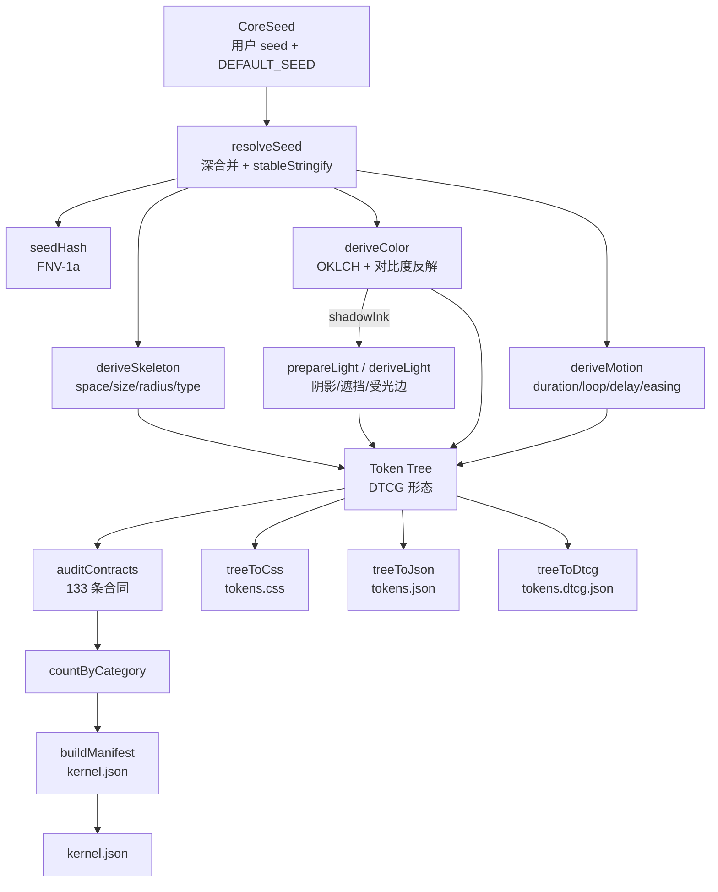

# 02 · 架构：一个纯函数内核，四种出口

> 结论先行：`@ultime/core` 是典型的「编译器式」架构——seed 是源码，`buildCore` 是前端，token 树是中间表示（IR），四个 exporter 是后端，`kernel.json` 是编译产物清单。整个系统没有运行时状态、没有插件系统、没有网络调用；所有复杂性都被压在模型层，出口层只做格式翻译。

## 设计目标与硬约束

从 `rules/01-architecture.md` 与 `AGENTS.md` 可以还原出五条架构约束：

1. **平台无关**：模型只产出值、量纲与 `$type`，不出现 `px`/`rem`/`var()`/`color-mix`（`AGENTS.md:22`）。
2. **方向单向**：`seed/model → build → exporters`，模型不得反向依赖（`rules/01-architecture.md` 的依赖图）。
3. **零第三方运行时依赖**：`dependencies` 只有同作者的 `@ultime/cli` 与 `@ultime/studio`（`package.json:91-94`）。
4. **单一装配点**：`src/build.ts` 是唯一把四个模型拼起来的地方（`src/build.ts:57-94`）。
5. **产物禁止手改**：`tokens.css`/`tokens.json`/`tokens.dtcg.json`/`kernel.json` 由 `pnpm build:tokens` 生成，pre-commit 重算比对（`AGENTS.md:17-18`）。

这些约束决定了架构形状：如果模型不能依赖 exporter，那么 exporter 必须是纯消费者；如果只能有一个装配点，那么模型之间不能互相调用，只能由 build 编排。

## 数据流

这张图的重点是**两条汇合线**：颜色先算出 `shadowInk`，再交给光影模型；四个模型的树在 build 层拼接，而不是模型互相 merge。前者保证「单墨」的一致性，后者保证依赖方向不交叉。

## 模块地图

| 层 | 目录/文件 | 职责 | 依赖 |
|---|---|---|---|
| 输入层 | `src/seed.ts` | seed 类型、默认值、深合并、JSONC 读取、哈希 | 无 |
| 中间表示 | `src/tree.ts` | Token/Group/值类型、构造器、walk/merge | 无 |
| 模型层 | `src/model/skeleton.ts` | 空间、尺寸、圆角、字号、字体、字重 | tree |
| 模型层 | `src/model/color/**` | OKLCH、中性 ramp、家族派生、报告 | tree |
| 模型层 | `src/model/light.ts` | 阴影、遮挡、环境光、受光边 | tree |
| 模型层 | `src/model/motion.ts` | 时长、循环、延迟、缓动族 | tree |
| 装配层 | `src/build.ts` | `buildCore`、`buildManifest`、`prepareLight` | 全部模型 |
| 合同层 | `src/contracts.ts` | 结构断言、颜色报告、计数 | tree |
| 出口层 | `src/exporters/css.ts` | 树→CSS 变量、暗色开关、reduced-motion | tree |
| 出口层 | `src/exporters/json.ts` | 树→JSON 快照 | tree |
| 出口层 | `src/exporters/dtcg.ts` | 树→DTCG，含 `$extensions` | tree |
| 工具层 | `src/tools/**` | 配置校验、产物导出、subset、semantics | build/exporters |
| CLI | `src/cli/**` | init/build/schema 三命令 | tools |
| Studio | `src/studio/**` | 可视化配置器适配层 | build/tools |
| 守卫 | `scripts/check-model.ts` | 零依赖、方向、类别隔离、载体语法 | 源码文本 |

模块地图里最值得注意的是**没有多层公共门面**：包的 `exports` 直接暴露根入口与 `./seed`、`./exporters`、`./tools`、`./studio` 五个代码入口，另带 `package.json`、`theme.example.json`、四份产物等数据入口（`package.json` 的 exports 字段）。这意味着每个子路径都是公开 API，升级时不能随便移动。

## 主流程：一次 `buildCore` 发生了什么

`buildCore` 只有 38 行，但它是整个系统的缩影（`src/build.ts:57-94`）：

1. **解析 seed**：`resolveSeed` 深合并默认值与用户输入，数字形式的语义色归一为 `{hue}`（`src/seed.ts:215-225`）。
2. **派生骨架**：`deriveSkeleton` 用 18 档 space、5 档 size、9 档 radius、9 档字号、4 档行高、5 档字距、2 套字体、3 档字重生成原语（`src/model/skeleton.ts:58-103`）。
3. **准备颜色与光影**：`deriveColor` 返回颜色树、色族、中性 ramp、画布、控件面、`shadowInk`、`onSide` 与报告；`prepareLight` 把 `shadowInk` 作为墨色传给 `deriveLight`，同时注入 `lightColor`/`ambientColor`（`src/build.ts:42-49`）。
4. **派生动效**：`deriveMotion` 按 unit×n 生成 duration/loop/delay，按 t 生成四种缓动（`src/model/motion.ts:47-94`）。
5. **拼树**：骨架全量展开；颜色取 surface/ink/line/tone/state/scrim 六个子组；再挂 shadow/occlusion/highlight/shade/motion（`src/build.ts:70-90`）。
6. **审计与计数**：`auditContracts` 生成 133 条记录，`countByCategory` 按类别统计（`src/contracts.ts:379-388`）。
7. **生成 manifest**：`buildManifest` 写 schemaVersion 6.0.0、engineVersion 0.5.0、seedHash、counts、contracts、color 报告与 artifacts（`src/build.ts:97-129`）。

`buildCore` 不写文件。写盘是 `scripts/build.ts` 或 `src/tools/tokens.ts` 的事；这种「计算与 IO 分离」让核心可以被 CLI、Studio、测试三方复用（`src/tools/tokens.ts:26-50`、`src/studio/index.ts:82-151`）。

## 关键设计决策

| 问题 | 方案 | 代价 | 替代方案 |
|---|---|---|---|
| 设计系统怎么表达「意图」而不是「值」？ | seed 只存色相、目标对比度、比例等参数，最终值由模型算 | 调试时需要理解求解逻辑，不能直接改某个 hex | 手写完整 token 清单；灵活但会漂移 |
| 一套 token 怎么同时服务 light/dark？ | 树里用 `ModeValue {light,dark}` 表示模式值，出口按需展开 | 每个模式值都要算两遍；树节点数翻倍 | 两棵独立树；简单但同步成本高 |
| 模型之间怎么共享「阴影墨」？ | `deriveColor` 先算 `shadowInk`，`prepareLight` 把它作为输入 | build 层需要知道颜色与光影的先后关系 | 光影自己选墨；会与 scrim/shade 不一致 |
| 怎么防止架构腐烂？ | 90 行静态守卫 + 零依赖检查 + 类别隔离 | 守卫是启发式，覆盖有限 | ESLint/TypeScript Program；更全面但更重 |
| 怎么保证产物可复现？ | 稳定序列化、FNV 哈希、manifest 无时间戳、`--check` 逐字节比对 | 构建结果不能包含环境信息 | 快照测试；只能发现变化不能证明合法 |
| 语义角色放哪？ | 不进 core；`semantics` 只写路径，由上层绑定 | 内核不能直接产出「按钮背景」这种名字 | 把 role 写进树；会污染平台无关性 |

## 树的结构与出口

树只有两种节点：`Token`（`$type`、`$value`、可选 `$description`）与 `Group`（递归）（`src/tree.ts:67-78`）。模式值是 `ModeValue`（`src/tree.ts:61-64`），由出口负责拆分：CSS 输出 `--x-light`/`--x-dark` 两个值位加一个无后缀开关（`src/exporters/css.ts:180-186`），DTCG 输出两个独立 token（`src/exporters/dtcg.ts:67-80`）。这种「树里一个节点、出口两种形态」的设计，让模型不必关心消费端。

CSS 出口还有两个细节：可缩放的 dimension 按 16px 基准转 rem（`src/exporters/css.ts:96`），并在 `prefers-reduced-motion` 下把 duration 压到 0.01ms、delay 归零，但 loop 不归零（`src/exporters/css.ts:192-198`、`214-218`）。后者是有意的：循环动画归零会变成无限高频闪烁。

## 质量属性

- **可测试性**：`buildCore` 是纯函数，测试只需 seed → 断言树/合同/manifest；`tests/core.test.ts` 283 行覆盖确定性、几何、颜色、光影、出口。
- **可移植性**：模型层零第三方依赖，理论上可跑在浏览器/边缘运行时；`check-model.ts` 的 core-dependency 规则就是为此服务。
- **可审计性**：manifest 带 counts、contracts、color report、artifacts；任何一次构建都能回答「用了什么 seed、过了多少合同、产出了什么」。
- **可扩展性**：加一个 token 类别需要同时改 tree 类型、模型、build 拼接、合同、测试五处；这是有意的摩擦，防止随手加 token。
- **性能**：常量级构建，详见 05 篇。

## 明确不做什么

`rules/01-architecture.md` 的五问边界写得很清楚：不做语义角色、布局、栅格/断点、材质轴、弹簧动画；`AGENTS.md` 还补充「语义与策略不进 core」（`AGENTS.md:20`）。这不是能力不足，而是产品定位：内核只回答「值是多少」，不回答「用在哪里」。一旦把 role 写进树，平台无关性就破了。

## 依赖图与包边界

把 `package.json` 的 exports 与 `check-model.ts` 的规则叠在一起，可以看到三条清晰的边界：

- **内核边界**：`.`（根入口，指向 `src/index.ts`）只导出 `buildCore`/`buildManifest` 等稳定 API；`./seed` 暴露类型与默认值，`./exporters` 暴露三个 exporter，`./tools` 暴露配置与产物工具。
- **可选边界**：`./studio` 是可选入口，只有需要可视化配置时才加载；`src/cli/**` 是内部命令行实现，不导出为包入口。`check-model.ts` 允许 `src/studio/**` 用 `@ultime/studio`、`src/cli/**` 用 `@ultime/cli`，但 core 的其他部分不能碰它们（`scripts/check-model.ts:38-56`）。
- **禁止边界**：`src/model/**` 不能 import `build`/`exporters`/`tools`/`studio`/`contracts`/`index`，四类模型（skeleton/color/light/motion）之间原则上也不能互相 import（`scripts/check-model.ts:66-72`；单文件类别的覆盖有限，见 04 篇）。共享类型可放 `src/tree.ts`，或新建 `src/model/types.ts`。

这条依赖图是**有向无环**的：seed/tree 是最底层，model 依赖 tree，build 依赖 model，exporters 依赖 tree，tools/cli/studio 依赖 build 与 exporters。任何一条反向边都会被守卫拒绝。它的好处是模型可以被单独测试、单独移植；代价是模型之间无法共享工具函数，`clamp`、`mix` 这类小工具只能在各自目录里重复，或者上移到公共层。

## 错误处理与失败模式

项目把失败分成三类，处理方式不同：

1. **输入错误**：seed 类型不对、配置字段拼错、subset 维度缺失、semantics 路径不存在——直接抛错并让 CLI 退出非 0（`src/tools/config.ts:44-131`、`src/tools/semantics.ts:110-156`）。这类错误不能静默修正，因为用户意图不明确。
2. **结构合同失败**：字号不递增、圆角不按公式、阴影层数不对——构建完成但 `contracts.failed > 0`，`scripts/build.ts:94` 退出 1。这类错误是代码 bug，不是设计取舍。
3. **颜色报告偏差**：某个面/线/墨达不到目标对比度——只写 warn，不阻断（`src/contracts.ts:374-375`）。这类错误可能是色域限制或品牌取舍，需要上层判断。

这个三分法比「全部抛错」或「全部警告」都更贴近真实工程：**输入错误必须停，结构错误必须修，审美偏差可以商量**。

## 扩展点与摩擦

架构没有插件系统，扩展靠改源码，这是有意的。三个主要扩展点：

- **新模型**：在 `src/model/` 下新建目录，实现纯函数，在 `build.ts` 里调用，在 `contracts.ts` 里加合同，在 `tree.ts` 里加类型。四步缺一不可。
- **新出口**：在 `src/exporters/` 下新建文件，只依赖 `tree.ts`，在 `src/tools/tokens.ts` 的 platforms 列表注册。出口不能反过来依赖模型。
- **新配置面**：seed 类型 → 默认值 → 模型消费 → 合同 → 测试 → Studio 字段，六处同步。

摩擦最大的地方是「加 token 要改五六个文件」，但这正是设计系统需要的：token 不是随手加的常量，而是要被派生、被验收、被导出的公共契约。

## 版本与兼容性

架构里有三个独立版本号，分别控制不同层：`package.json` 的包版本、`SCHEMA_VERSION`（6.0.0，`src/version.ts:8`）、`ENGINE_VERSION`（0.5.0，`src/version.ts:9`）。包版本管 npm 发布，schemaVersion 管 token 树/manifest 结构，engineVersion 管派生算法。三者分开意味着：算法可以升级而不改 schema，schema 可以升级而不发新包；反过来，任何一层变化都要在发布说明里写清。

`rules/04-release.md:9-15` 要求三类版本分别递增，`buildManifest` 把 schemaVersion 与 engineVersion 同时写进 `kernel.json`（`src/build.ts:97-129`）。这让下游可以在读取产物前先检查版本，而不是靠猜。一个已知的不一致是 `src/exporters/json.ts:32` 把 JSON 的 `schemaVersion` 硬编码成 `'4.0.0'`，与 `src/version.ts` 的 6.0.0 不同；这看起来是历史遗留，升级前应视为待查实问题，不要依赖这个字段判断整体 schema 版本。

## 架构评价

优点：**依赖图干净、可复现性强、出口与模型解耦**。这套结构适合任何「一份源数据 → 多种目标格式」的编译器型项目。

风险：**根入口与四个子入口都是 API 面**，0.x 阶段任何路径调整都是破坏性变更；**模型层四类互不 import** 在需要共享工具时会逼你复制代码或上移到 `src/tree.ts`／新建类型模块；**合同数量 133 条**意味着新增 token 的维护成本不低。项目用 `rules/04-release.md` 的三类版本号（包版本/schemaVersion/engineVersion）来管理这些风险，但还没有自动化迁移工具。

如果重来一次，我会做两处调整：其一，新建 `src/model/types.ts` 作为显式共享层，允许四个类别依赖它但不互相依赖，减少工具函数复制；其二，把 JSON 出口的 `schemaVersion` 改为从 `src/version.ts` 读取，消灭当前 4.0.0/6.0.0 的不一致。两处都不影响整体架构，属于实现层的债务，而不是设计缺陷。对读者来说，这套架构最值得抄的不是某个函数，而是「输入只有一处、装配只有一处、验收只有一处」的收敛方式：它让每次改动都能被定位、被重算、被证明。
