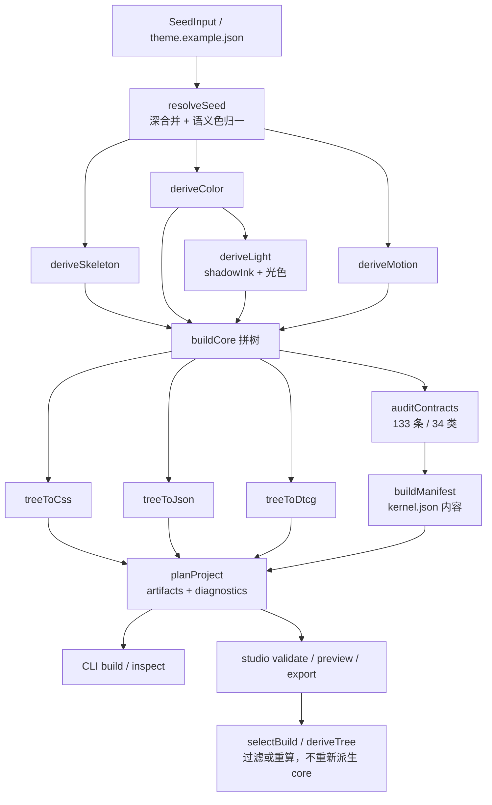

# 02 · 架构：五层、一棵树、一次构建

**这篇回答什么问题**：`@ultime/core` 由哪些模块组成，数据从 seed 到四份产物怎么流动，哪些设计决策决定了它现在的形状。

## 系统上下文

这是一个 **构建期库 + CLI**，不是服务：

- 运行在 Node.js（`engines.node >= 22.18`，`package.json:70-72`），没有端口、没有数据库、没有网络调用。
- 输入是 `SeedInput`（JSON/JSONC 对象），输出是内存中的 `ProjectBuild`：`core` / `manifest` / `artifacts` / `diagnostics`（`src/tools/project.ts:35-41`）。
- 宿主可以是 `ultime build` CLI、`@ultime/core/tools` 的程序化调用，或 `@ultime/core/studio` 的配置器适配层。
- 唯一的第三方依赖是 `@ultime/cli` 与 `@ultime/studio`，且分别只允许出现在 `src/cli/**` 与 `src/studio/**`（`scripts/check-model.ts:47-51`）；模型与出口本身不依赖任何第三方运行时包。
- 包本身没有副作用：构建过程不读盘、不写盘、不取时间，文件 I/O 只发生在 CLI（读配置/seed）与 `scripts/build.ts`（写产物）这两层。

把“库”和“执行器”分开，是这个仓库所有可复现性讨论的前提：`buildCore` 是纯函数，CLI 只是把它的返回值落到磁盘。只要输入 seed 和包版本相同，任何人、任何机器都能得到同一份字节。

## 模块地图

| 层 | 路径 | 职责 |
| --- | --- | --- |
| 输入 | `src/seed.ts` | `CoreSeed` 类型、`DEFAULT_SEED`、深合并、语义色归一、`stableStringify`、FNV-1a `seedHash`、JSONC 读取 |
| 中间表示 | `src/tree.ts` | 只有 `Token` / `Group` 两种节点；`DimensionValue` / `ColorValue` / `ShadowLayerValue` / `ModeValue` 等平台无关值类型 |
| 模型 | `src/model/skeleton.ts` | 18 档 space、5 档 size、9 档 radius、9 档字号、4 档行高、5 档字距、2 条字体栈 |
| 模型 | `src/model/color/**` | 中性灰阶、主色/语义色族、面阶、墨、线、状态、阴影墨与颜色报告 |
| 模型 | `src/model/light.ts` | 4 档 shadow、4 档 occlusion、`highlight.key/ambient`、`shade.key`，以及 `solve()` |
| 模型 | `src/model/motion.ts` | duration / loop / delay / easing 四轴 |
| 装配 | `src/build.ts` | `buildCore` 唯一装配点；`buildManifest` 只读结果；`solveLight` 独立入口 |
| 合同 | `src/contracts.ts` | 133 条合同、34 类 ID；结构合同阻断，颜色项只报告 |
| 出口 | `src/exporters/css.ts` / `json.ts` / `dtcg.ts` | 同一棵树翻译成 CSS、原生 JSON、DTCG 2025.10 |
| 编排 | `src/tools/project.ts` | `planProject` 一次派生 → `ProjectBuild`；`exportArtifacts` 兼容入口 |
| 编排 | `src/tools/tokens.ts` / `config.ts` / `semantics.ts` | 产物选择与目录、配置校验、可选语义表 |
| 配置器 | `src/studio/**` | `themeStudio` 字段/预设/校验/预览/导出；0.7 的 `selectBuild` / `selectTree` / `deriveTree` |
| CLI | `src/cli/**` | `init` / `build` / `inspect` / `schema` 四命令 |
| 守卫 | `scripts/check-model.ts`、`scripts/build.ts` | 依赖方向/类别隔离/载体语法；`--check` 逐字节比对产物 |

## 公开出口与依赖边界

`package.json` 的 `exports` 把能力拆成五个入口，每个入口对应一种消费者：

| 入口 | 提供 | 典型消费者 |
| --- | --- | --- |
| `@ultime/core` | `buildCore` / `buildManifest` / `solveLight` / 树工具 / 合同 / 版本 | 想自己编排流程的高级用户 |
| `@ultime/core/exporters` | `treeToCss` / `treeToJson` / `treeToDtcg`；只读树 | 已有构建系统，只借出口 |
| `@ultime/core/tools` | `planProject` / `exportTokens` / `exportArtifacts` / 配置校验 / 语义表模板 | CLI、项目脚手架、脚本 |
| `@ultime/core/studio` | `themeStudio` 与 `selectBuild` / `selectTree` / `deriveTree` | 可视化配置器宿主 |
| `@ultime/core/seed` | seed 类型 / 默认值 / 深合并 / JSONC / 指纹 | 需要读 seed 或做 schema 表单的工具 |

这条边界不是按“文件目录”划的，而是按“谁能依赖谁”划的。`scripts/check-model.ts` 检查三件事：非相对 import 只允许 `@ultime/studio`（studio 内）和 `@ultime/cli`（cli 内）；相对 import 不得逃出 `src/`；`model/**` 不得反向 import 上层模块（`check-model.ts:41-63`）。因此“core 零依赖”要精确表述为：**模型与出口零第三方运行时依赖**，不是整个包零依赖。

## 数据流

主链路的函数顺序在 `src/build.ts:57-94`：`resolveSeed` → `deriveSkeleton` → `prepareLight`（内部先 `deriveColor` 再 `deriveLight`）→ `deriveMotion` → 拼树 → `auditContracts` → `countByCategory`。`prepareLight` 的存在说明颜色和光影不是并列的：光影必须拿到颜色算出的唯一 `shadowInk` 才能开始（`src/build.ts:41-49`）。

返回的 `CoreResult` 有八个字段：`seed`、`tree`、`skeleton`、`color`、`light`、`motion`、`contracts`、`counts`（`src/build.ts:84-93`）。这不是“多返回几个对象”，而是把派生中间量一起留给合同、manifest 和 studio——`auditContracts` 需要 `skeleton/color/light/motion` 才能检查公式，`buildManifest` 需要 `seed/motion/counts/contracts/color` 才能写 kernel，`deriveTree` 需要 `light.solve` 才能重算光影。树本身反而只是这些结果的最终投影。

0.6 起，上层不再直接拼产物：`planProject` 只调用一次 `buildCore`，把 `core` / `manifest` / `artifacts` / `diagnostics` 一起返回（`src/tools/project.ts:65-115`）。0.7 的 `selectBuild` 只消费这份 `ProjectBuild`，从 `build.core.tree` 过滤，产物不含 `kernel.json`（`src/studio/selection.ts:219-283`）。

## ProjectBuild 数据契约

`ProjectBuild` 是整个工具层的“事务边界”（`src/tools/project.ts:35-41`）：

- `config`：已经过 `validateConfig` 的 `UltimeConfig`，字段只有 `tokens.seed/platforms/output/semantics`；
- `core`：`CoreResult`，永远是全量派生；
- `manifest`：`buildManifest(core)` 的结果，也就是 `kernel.json` 的内容；
- `artifacts`：`PlannedArtifact[]`，每项含 `path`、`content`、`bytes`，`bytes` 由 `TextEncoder` 计算（`:43`）；
- `diagnostics`：`BuildDiagnostic[]`，`level` 为 `error | warn | info`，带 `code`、`message`、`path`。

`planProject` 的顺序是：先 `validateConfig`（错误直接抛，带 `配置：` 前缀），再 `resolveInputSeed`（字符串 seed 明确拒绝，要求调用方先读盘，`:45-51`），然后 `buildCore`、`emitTokens`、`contractDiagnostics`，最后可选地校验 semantics 并把 `semantics.json` 追加进 artifacts（`:65-115`）。

这个设计和“每个入口自己调 `buildCore`”相比多了一个对象，但换来了三个能力：同一份构建事实可以被 CLI、studio、脚本共享；诊断可以和产物一起返回而不必抛异常；未来加缓存/序列化只需要针对 `ProjectBuild` 一个类型。

## 部署拓扑

没有“部署”这个概念，只有三种运行形态：

1. **CLI 进程**：`ultime build` 读 `ultime.config.json`，在进程内构建并写四份文件；`--check` 不写盘，只逐字节比较（`scripts/build.ts:38-48`）。
2. **程序化调用**：`import { planProject } from '@ultime/core/tools'`，把 `artifacts` 交给自己的构建系统。
3. **配置器适配层**：`@ultime/core/studio` 的 `themeStudio` 在宿主进程内缓存一份 `ProjectBuild`（`src/studio/index.ts:30-46`），预览与导出共享。

没有后台任务、线程池、IPC 或端口；所有复杂度都在一次同步调用里。这也意味着它不适合“运行时按用户请求生成主题”的场景——那是另一个产品形态，缓存与并发要重新设计。

## 关键设计决策

| 问题 | 方案 | 代价 | 替代方案 |
| --- | --- | --- | --- |
| token 值从哪来 | seed 只存意图，值由公式/对比度反解（`src/build.ts:57-94`） | 无法直接手改某个 token；改值必须找 seed 或改模型 | 维护完整 token 清单，工具只做格式转换 |
| 多出口如何不漂移 | 一棵 `Group` 树作为唯一 IR，三个 exporter 只翻译（`src/tree.ts:1-15`） | 出口不能偷偷补值；新增平台要写新 exporter | 每个平台单独维护模板/变量表 |
| 错误何时暴露 | 构建时合同审计，结构失败 `failed` 阻断，颜色偏差只报告（`src/contracts.ts:159-375`） | 每次构建多一次全树遍历 | 靠 code review / 单独测试套件 |
| 上层怎么拿到一致结果 | `planProject` 一次派生返回所有产物与诊断（`src/tools/project.ts:65-115`） | 0.6 的 Breaking：删掉 `tokens.subset` / `tokens.config.json` | CLI、studio、脚本各自调用 `buildCore` |
| 定制产物放哪 | `selection` / `derivation` 是配置器配置，core 永远产完整树（`src/studio/selection.ts:1-7`） | 选择不能写进 `ultime.config.json`，需要另存 studio 配置 | 让 core 接受 subset；0.5 试过，0.6 删了 |
| 同 seed 为何逐字节相同 | `stableStringify` 键排序 + FNV-1a + manifest 无时间戳/绝对路径（`src/seed.ts:228-246`、`src/build.ts:96-127`） | FNV 不是加密哈希，碰撞不可用于安全场景 | 时间戳 + 随机构建号，便于追踪但不可复现 |
| 方向怎么长期守住 | `scripts/check-model.ts` 机械扫描 import + 序列化树（`scripts/check-model.ts:38-82`） | 正则不是 AST，存在覆盖盲区 | ESLint 规则 + 人工评审 |

## 诊断模型

`BuildDiagnostic` 不是异常的替代品，而是构建结果的一部分（`src/tools/project.ts:26-33`）。目前有三类来源：

1. **配置错误**：`validateConfig` 直接抛 `配置：...`，因为配置不合法时继续构建没有意义；`semantics` 校验失败则记 `semantics.invalid`，因为语义表是可选产物。
2. **合同诊断**：`contractDiagnostics` 把每个非 `pass` 的合同行转成 `contract.<id>`；`blocking` 的失败是 `error`，颜色/启发式是 `warn`，`path` 统一为 `/tokens/seed`（`:53-62`）。
3. **选择/派生诊断**：`selection.*` / `derivation.*`，由 `selectBuild` 与 `deriveTree` 追加；包括未知类别、未知档位、非正整数、缺失档位、空选择、非法形态。

诊断是数组而不是流：调用方可以过滤、聚合、翻译成自己的错误码。`studio.validate` 只取前 12 条 `contract.*`（`src/studio/index.ts:150-155`），避免一次返回上百条 UI 噪声；这是产品层对诊断的再加工，不是 core 的规则。

## 版本与兼容

版本有两个轴（`src/version.ts:8-9`）：

- `SCHEMA_VERSION = '6.0.0'`：树与合同字段的兼容面。树节点类型、`$type`、合同语义变化时升；
- `ENGINE_VERSION = '0.7.0'`：派生实现。公式、默认目标、算法变化时升。

`kernel.json` 同时写两个版本和 `seedHash`，下游升级前对比两份 manifest 就能判断“是数据变了还是算法变了”（`README.md:282-288`）。0.7.0 只升 engine，树/合同/快照不变；0.5.0 是契约刷新（`rim` → `highlight.ambient`）。这套双版本设计比单一 semver 更细，但也要求维护者自觉：`tokens.json` 里仍硬编码 `schemaVersion: '4.0.0'`（`src/exporters/json.ts:32`），说明“版本单一来源”尚未覆盖所有出口。

## 构建与发布边界

这个仓库只包含 `@ultime/core` 一个包，但它的 `dependencies` 里有 `@ultime/cli` 与 `@ultime/studio`（`package.json`）。这不是“core 依赖两个 UI 库”，而是把共享的命令行框架与配置器框架作为独立包发布，再由 core 在对应子目录里使用：

- `src/cli/**` 用 `@ultime/cli` 的 `runCli` / `processContext`，只保留命令语义；
- `src/studio/**` 用 `@ultime/studio` 的 `defineConfigurator`，只保留字段/预设/选择/派生；
- 模型、合同、出口不 import 这两者，`check-model.ts` 的 `core-dependency` 会拦截越界（`scripts/check-model.ts:41-53`）。

构建分两段：`tsx scripts/build.ts` 生成 token 产物，`vp build` 打 `dist/*.js` 与 `bin/ultime.js`。`package.json` 的 `files` 字段把 `bin`、`dist`、`src`、`tokens.*`、`kernel.json`、`theme.example.json` 以及 README / DESIGN / CHANGELOG / CONTRIBUTING / SECURITY / AGENTS / rules / llms.txt / skills.md / agent.md 一起发布；`prepublishOnly` 是 `pnpm check && pnpm test && pnpm build`，所以手动 `npm publish` 也会先跑全套检查。

这套边界带来一个实际约束：**core 不能为了自己方便去改 cli/studio 包的 API**。如果 `defineConfigurator` 的签名变了，core 的 studio 层要跟着升依赖；反过来，core 的树类型变化不会影响 cli/studio，因为两者只通过 core 的公开出口交互。推断：发布顺序因此是 cli/studio 先、core 后（见 07），否则 core 安装时会拉到不存在的依赖版本。

## 三份事实的对账关系

构建结束后有三份“看起来都在描述系统”的东西，职责必须分清：

1. **树**（`core.tree`）：唯一的 token 事实，274 个叶子，所有出口都从这里翻译；
2. **合同报告**（`core.contracts`）：对树的审计结论，133 行、34 类，不是第二棵树；
3. **manifest**（`core.manifest`）：对“这次构建”的摘要，含 seed、seedHash、版本、计数、合同摘要、颜色报告，不重复 token 值。

对账顺序是：先看 `manifest.counts.total` 与 `countTokens(tree)` 是否一致（`countByCategory` 的结果就是 manifest 的 counts）；再看 `manifest.contracts.failed` 是否为 0；最后看 `manifest.color.levels` 的 pass/warn 分布。三份都对齐，才说明“树、合同、摘要”没有互相漂移。

反例：如果只改 `buildManifest` 里的 counts 计算，树没变，`--check` 会发现 kernel 变了但 tokens 没变；如果只改 `countByCategory`，合同里的 `type-steps` 等仍按树判断，manifest 的 counts 会先失真。这也是为什么 `countByCategory` 放在 `buildCore` 内部（`src/build.ts:81-82`），而不是让 manifest 自己数。

## 架构亮点

1. **纯函数装配点**：`buildCore(input: SeedInput = {}): CoreResult` 不读文件、不写文件、不取时间，输入输出都可序列化（`src/build.ts:57-94`）。这使 CLI、studio、测试能共享同一份构建事实。
2. **单一构建计划**：`ProjectBuild` 把 `core`、`manifest`、`artifacts`、`diagnostics` 绑在一次派生上，诊断中的 `contract.*` 直接来自同一份合同报告（`src/tools/project.ts:53-62`）。
3. **合同分级**：`ContractRow.blocking` 决定是否阻断；颜色行由 `colorRows` 统一设为 `blocking: false`，`failed` 只数 `blocking && !pass`（`src/contracts.ts:144-156`、`:374-375`）。
4. **颜色的“目标单一来源”**：`src/model/color/targets.ts:1-26` 同时被派生和合同引用，避免“派生用一套数字、验收用另一套”。
5. **光影五槽的可求解闭包**：`deriveLight` 返回的 `solve(input)` 支持 `form/depth/mode`，静态树只写 `convex`，`flat` / `concave` 在配置器里按需重算（`src/model/light.ts:181-195`）。
6. **选择是纯过滤**：`selectTree` 不依赖 `ProjectBuild`，只遍历树、按数字 key 过滤；`selectBuild` 才负责诊断和产物（`src/studio/selection.ts:188-216`）。
7. **可复现 manifest**：`buildManifest` 只包含版本、seed、seedHash、unit、motion、counts、contracts、color；没有 `artifacts` 和 `themeModes`（0.6 删除，`src/build.ts:96-127`）。

## 读架构时最容易误解的点

- **“零依赖”只指模型/出口**：`@ultime/cli` 和 `@ultime/studio` 仍是包依赖，只是被限制在 `src/cli/**` / `src/studio/**`（`scripts/check-model.ts:47-51`）。
- **`kernel.json` 不是运行时主题**：它是构建 manifest，给下游比对版本、计数与合同摘要；真正的 token 在 `tokens.css` / `tokens.json` / `tokens.dtcg.json`。
- **`tokens.json` 的 `schemaVersion: '4.0.0'` 是历史遗留**：内核 `SCHEMA_VERSION` 已是 `6.0.0`（`src/version.ts:8`），但 `src/exporters/json.ts:32` 仍硬编码 `4.0.0`。这是当前代码的真实不一致，升级前应核对。
- **`selection` 不是 core 的输入**：`buildCore` 永远产完整树；`selectBuild` 只过滤结果（`src/studio/selection.ts:1-7`）。
- **274 个 token 与 133 条合同不是同一个计数**：前者是树叶子数，后者是审计行数；颜色报告 106 条只是合同的一部分，且不阻断。
- **模式值不是两个 token**：树里一个 `ModeValue {light,dark}`，CSS 才拆成 `-light`/`-dark` 两个值位，DTCG 才拆成两个 token（`src/exporters/css.ts:180-186`、`src/exporters/dtcg.ts:67-80`）。
- **`unit` 是 manifest 的元数据不是 token**：`buildManifest` 明确写“1 逻辑像素 = 1 iOS pt = 1 Android dp = 1 CSS px@1x”，而 CSS 出口把可缩放长度除 16 转 rem（`src/build.ts:102-106`、`src/exporters/css.ts:90-119`）。同一份 `DimensionValue` 在不同平台换单位，但模型本身不写 `px`/`rem`。

**一句话记住**：这个架构的核心不是“分层”，而是“只允许一份事实”——seed 是唯一输入，树是唯一中间表示，`ProjectBuild` 是唯一构建结果，其余都是翻译、过滤或报告。
