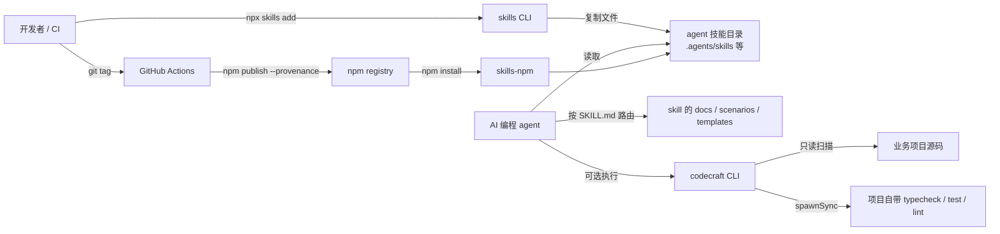
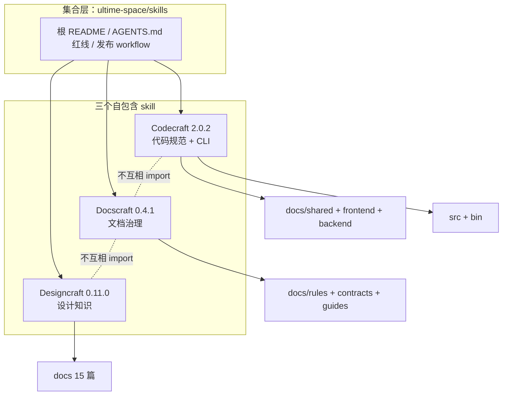
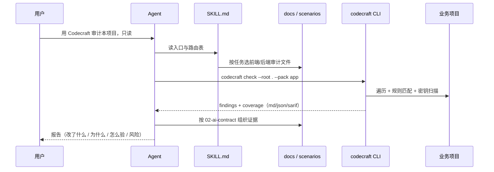
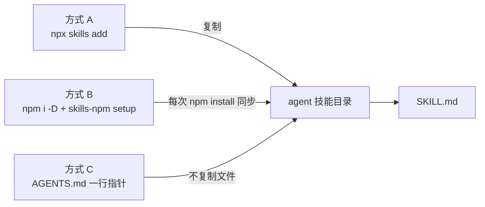
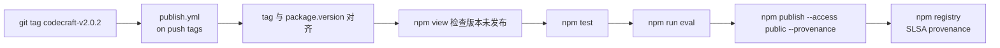

# 02 · 架构：一个内容仓库、一个本地 CLI、三条发布链

> 这篇回答什么问题：这个仓库运行时到底由哪些部分组成？安装、读取、执行、发布四条链路怎么闭合？哪些设计是刻意的，代价是什么？

## 结论先行

ultime-space/skills 不是应用，而是**一个内容仓库 + 一个本地 CLI + 三条发布流水线**。运行时没有服务端、数据库、端口；真正的「运行时」是 agent 读 `SKILL.md` 的上下文加载，以及 Codecraft CLI 的本地扫描。仓库根只有 8 个文件（`README.md`、`AGENTS.md`、`SECURITY.md`、`.gitignore`、`.github/workflows/` 下 4 个），不设 `package.json`、不设统一版本（`git ls-files`）。

## 系统上下文

外部依赖只有四个：文件系统、git（`--changed/--since` 需要）、shell（gates 需要）、npm（安装与发布）。CLI 不发网络请求——这一点写在 README 的边界里（`skills/codecraft/README.md:461-470`），也能从代码验证：`src/` 七个模块只 import `node:fs` / `node:path` / `node:child_process` / `node:url`。

## 模块地图

| 模块 | 职责 | 关键入口 |
|---|---|---|
| 仓库根（8 文件） | 集合索引、安装入口、AI 协作红线、安全策略、发布约定 | `README.md`、`AGENTS.md`、`SECURITY.md`、`.github/workflows/` |
| `skills/codecraft`（114 文件） | JS/TS 代码规范与架构：A1–A21、前端/后端族卡、CLI、脚手架、测试/evals | `SKILL.md`、`bin/codecraft.mjs`、`src/cli.mjs` |
| `skills/docscraft`（32 文件） | 文档分层、单一真源、规则治理、ADR、漂移检查 | `SKILL.md`、`docs/rules/`、`docs/contracts/` |
| `skills/designcraft`（49 文件） | 设计知识：颜色、排版、空间、布局、光影、动效、结构方案、类型倾向、评审 | `SKILL.md`、`docs/`、`scenarios/` |
| `.github/workflows` | CI（三个 skill 并行）与三条 tag 触发的发布流水线 | `ci.yml`、`publish*.yml` |

三个 skill 的目录形状高度一致：`SKILL.md` + `README.md` + `docs/` + `scenarios/` + `prompts/` + `templates/` + `tests/` + `evals/` + `scripts/` + `VERSION` + `CHANGELOG.md` + `LICENSE` + `CONTRIBUTING.md` + `SECURITY.md` + `package.json`。Codecraft 多出 `src/`、`bin/`、`adapters/`、`codecraft.config.example.json` 与 `pnpm-lock.yaml`。

## 三个 skill 的内容分层

- **Codecraft：18 篇 docs 分三层**。`docs/shared/` 11 篇放所有端共用规则（宪法、AI 契约、审计契约、门禁、模式、提示词、安全、身份、存储、术语）；`docs/frontend/` 4 篇（族卡、风格总图、架构、审计判定）；`docs/backend/` 4 篇（族卡、风格总图、架构、审计判定）。分层目的是「先读共享规则，再只读对应端」，避免一次把前后端两套模板都塞进上下文（`skills/codecraft/SKILL.md:31-51` 的路由表就按这个前提写）。
- **Docscraft：10 篇 docs 按「规则 / 契约 / 指南」分**。`docs/rules/` 5 篇（原则、分层、文档类型、规则类型、文档安全）；`docs/contracts/` 2 篇（AI 入口契约、交付前清单）；`docs/guides/` 2 篇（防漂移、ADR）；另有 `docs/glossary.md`。
- **Designcraft：15 篇 docs**。`docs/README.md` 做索引，其余 14 篇覆盖 foundations、color、typography、space-shape、layout、depth、motion、states、data-graphics-content、composition、patterns（结构方案库）、project-types（类型倾向）、review、style。它没有自动检查器，价值在判据、取档建议与评审语言。

## 运行时读取契约

agent 的读取顺序被 `SKILL.md` 固定成一条链：先读范围、目录与路由表；再读 `docs/shared/00-constitution.md`；然后只读对应端的族卡；需要时选 `scenarios/`；按 `docs/shared/02-ai-contract.md` 输出；审计任务再读 `08-audit-contract.md` 与对应端审计文件（`skills/codecraft/SKILL.md:53-67`）。

顺序固定减少随机加载，也避免「先读族卡、把具体模板当规则」这个常见错误。Designcraft 的 `SKILL.md` 同样把「确认范围 → 找判据 → 换算 → 给最近可行档 → 按 prompts 输出」写成五步（`skills/designcraft/SKILL.md:74-80`）。

## 集合层与三个 skill 的职责边界

边界不是按文件数分的，而是按**判断类型**分的：Codecraft 判断「代码结构与依赖方向」，Docscraft 判断「文档是否有唯一真源、是否过期」，Designcraft 判断「视觉决策有没有判据」。三者都写了「不做什么」：Codecraft 不做业务架构（`skills/codecraft/SKILL.md:16`），Docscraft 不写代码架构（`skills/docscraft/SKILL.md:16`），Designcraft 不做强制检查、不下阻断结论（`skills/designcraft/SKILL.md:16`）。

## 数据流：一次审计从输入到输出

关键在「双层证据」：CLI 只负责高置信静态规则（A2/A6/A11/A17/A21），A1–A5、A7–A16、A18–A20 由 agent 按族卡与审计契约人工判定。宪法「机检现状」一节明确列出这两组（`skills/codecraft/docs/shared/00-constitution.md:315-319`），CLI 的 `coverage.rules[id].limitations` 也在每次输出里重复同一事实（`skills/codecraft/src/check.mjs:156-172`）。这避免了「静态扫描 0 findings = 架构没问题」的误读。

报告默认 Markdown 而不是 JSON：Markdown 给人读，JSON 给 CI 与趋势，SARIF 给 Code Scanning；三种格式共用同一份 findings，格式只影响渲染。README 把这条写成「契约自 2.0.0 起冻结，字段只增不改语义」（`skills/codecraft/README.md:307-313`）。

## 安装链路：三条路，同一份内容

- **A**：`npx skills add ultime-space/skills --skill='*'`，交互选 agent；`-g` 装到用户目录，`-a` 指定 agent（`README.md:14-42`）。
- **B**：`npm i -D @ultime/codecraft @ultime/docscraft @ultime/designcraft skills-npm`，再 `npx skills-npm setup`；每次 `npm install` 把 `node_modules/@ultime/*` 同步到 `.agents/skills/` 及检测到的 agent 目录，要求 Node >= 22.20（`README.md:64-71`）。
- **C**：不复制文件，只在通用入口 `AGENTS.md` 留一行指针（`README.md:73-84`、`skills/codecraft/adapters/generic/AGENTS.md`）。

三条路的产品含义：**分发与内容解耦**。仓库不维护 agent 列表，skill 内也不放安装器。这是它能保持 203 个文件、零运行时依赖的前提。

## 发布链路：tag → OIDC → npm provenance

三条流水线同构，只是包名/目录不同：`publish.yml`（codecraft）、`publish-docscraft.yml`、`publish-designcraft.yml`。共同约束：`permissions: contents: read, id-token: write`、先 `npm install -g npm@11`、tag 必须等于 `<skill>-v<version>`、发布前 `npm view` 检查版本未占用、发布前跑 test 与 eval、`npm publish --provenance`（`.github/workflows/publish.yml:1-51`）。

## 部署拓扑

- **本地开发机**：一次 `check` 的进程生命周期是「Node 启动 → 遍历 → 匹配 → 输出 → 退出」，没有 daemon、没有常驻缓存；唯一持久状态是 `codecraft-baseline.json`（如果启用）。
- **CI**：GitHub Actions `ubuntu-latest` + Node 22；三个 job 并行、互不依赖，某个 skill 测试失败不阻塞另外两个（`.github/workflows/ci.yml:1-55`）。
- **发布**：GitHub Actions 临时进程，通过 OIDC 换发布权限，不持久化 token；`workflow_dispatch` 可手动重跑，但仍要求 tag 与版本一致。
- **数据目录**：无。CLI 只读项目文件；写操作仅 `init --apply`（骨架）与 `--update-baseline`（基线文件）。

## 为什么不做成 pnpm workspace

仓库根没有 `package.json`，也没有 workspace 配置；三个 skill 各自有 `package.json`，Codecraft 还带 `pnpm-lock.yaml`。这是刻意选择：workspace 会带来版本联动，而用户通常只装其中一个包。代价是三个 `release-check.mjs`、三个 `structure.test.mjs`、三个 `check-package-content.mjs` 重复，改一处要改三处。

2026-11 的 `7381abe` 新增发布内容检查，同样三份复制——脚本留在包内，才能保证「单独拷贝出去也能自检」（`skills/codecraft/scripts/check-package-content.mjs:1-16`）。

## 关键设计决策

| 问题 | 方案 | 代价 | 替代方案 |
|---|---|---|---|
| 多 agent 安装碎片化 | 交给 `skills` CLI / `skills-npm`，仓库只写内容 | 安装体验受外部 CLI 制约；Node >= 22.20 | 自研安装器，维护 75+ agent 路径 |
| 规则正文放哪 | `SKILL.md` 只做入口，正文全在 `docs/` | agent 需多跳读取，首轮上下文更重 | 全塞进 SKILL.md，单文件但必然重复 |
| 三个 skill 怎么组织 | 扁平目录、独立 package、独立 semver、互不 import | 无法共享代码，脚本重复三份 | pnpm workspace 共享包，但增加构建耦合 |
| 静态检查覆盖多少 | 只做高置信文本规则，其余交人工/项目门禁 | 覆盖有限，0 findings 不代表通过 | 做完整 AST/类型分析，复杂度和误报上升 |
| 存量项目怎么上 CI | baseline 快照存量，只拦新增；ignore 需理由+到期 | 需维护基线文件与到期清理 | 一次性全量阻断，落地阻力大 |
| 2.0 的 audit 默认跑不跑 gates | 默认不跑，必须 `--run-gates`，未跑 stderr 告警 | 升级迁移成本；忘记加 flag 会少一道门 | 保持 1.x 默认执行，但隐式执行任意命令风险更高 |
| 内部材料怎么不进包 | `files` 白名单 + `npm pack --dry-run` 实际清单扫描 | 每个包多一个脚本、多一次 pack 调用 | 只靠人工 review，红线靠自觉 |

## 架构亮点（带证据）

1. **规则 ID 宪法化，可逐条引用**。A1–A21 每条有 ID、理由、正例/反例、验收、范围要求（`skills/codecraft/docs/shared/00-constitution.md:40-64`），`plan` 输出带 `constitution` 列指回条款（`skills/codecraft/src/plan.mjs:29-41`）。
2. **pack 决定规则集，`--rules` 只能取交集**。`PACK_RULES` 定义 app/library/design-system 三套（`skills/codecraft/src/cli.mjs:23-27`）；`--rules` 全部不在 pack 内直接 exit 2，避免静默变绿（`skills/codecraft/src/cli.mjs:157-175`）。
3. **fail-closed 的 threshold**。gate 输出解析不出 issue 数时 `violated=true`，宁可误杀不可放过（`skills/codecraft/src/gates.mjs:169-185`）。
4. **baseline 指纹不含行号**。`rule|file|message` 的指纹让编辑代码不让基线失配，路径统一为 `/`（`skills/codecraft/src/baseline.mjs:13-16`）。
5. **报告先脱敏再进上下文**。gate 输出全文捕获后先过 `redactSecrets`，私钥、Authorization、带凭据连接串替换（`skills/codecraft/src/gates.mjs:8-13`、`:204-249`）。
6. **SKILL.md 是路由表，不是规则仓库**。Codecraft SKILL.md 末句「规则正文只在 `docs/`；本文件只做入口」（`skills/codecraft/SKILL.md:102`），结构测试检查所有 docs 都能从 SKILL.md 到达（`skills/codecraft/tests/structure.test.mjs:112-119`）。
7. **红线机器化**。`AGENTS.md:9-15` 写着「子包不写 Ultime 内部材料」，`check-package-content.mjs` 把这条变成 `internal-repo-path` / `internal-package` / `absolute-path` 三类规则，扫的是 `npm pack` 的真实清单而不是目录（`skills/codecraft/scripts/check-package-content.mjs:56-84`）。

## 这套架构的代价

自包含换来了重复：三个 skill 各有 LICENSE、CHANGELOG、VERSION、package.json、结构测试、release-check、发布内容检查，改一个通用约定要同步三份。根目录没有 package.json，也没有统一 `npm test`，新人必须知道进每个目录跑。安装归集合虽然统一了入口，但 CLI 与内容分离，用户可能装了 skill 却没装 codecraft 包。

这些不是缺陷，是「用重复换独立」的明确取舍。skill 数量增长到十个以上，重复成本会超过独立收益，那时再抽共享包才划算。

## 读架构时最容易误解的点

- **`SKILL.md` 不是完整规则**。Codecraft 的只有 102 行，正文在 `docs/` 的 18 篇里；只读 SKILL.md 会以为规则很少。
- **`audit` 默认不跑 gates**。2.0 起必须 `--run-gates`，否则只在 stderr 告警，且不改退出码（`skills/codecraft/src/cli.mjs:278-282`）。
- **`--changed` 不是增量扫描**。底层仍全量扫描，只过滤 findings；`coverage.scanned` 仍是全量文件数（`skills/codecraft/src/cli.mjs:176-210`、`skills/codecraft/README.md:312`）。
- **根 README 的目录树已修正**。旧分析说 `README.md:93-96` 有笔误，当前 `README.md:87-121` 的树与 `git ls-files` 一致（`skills/` 下三个目录、designcraft 的 `docs/` 含「结构方案」）。旧结论作废。

> 一句话记住：**这是「内容仓库 + 本地检查器 + OIDC 发布链」的三层结构，运行时在 agent 的上下文里，不在服务器上；它的每个结论都能落回一个可验证的文件——规则落回宪法条款，输出落回 findings 字段，发布落回 provenance，红线落回打包清单扫描。**
